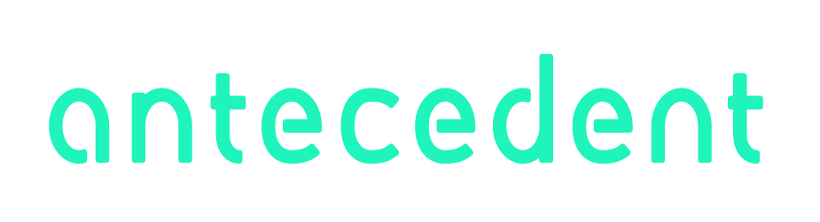

[](https://github.com/iridae-dev/antecedent/actions/workflows/ci.yml) [](https://crates.io/crates/antecedent) [](https://pypi.org/project/antecedent/) [](https://github.com/iridae-dev/antecedent/releases/latest) [](https://doi.org/10.5281/zenodo.21556247)



**Antecedent is a compiler and evidence-aware runtime for causal science.** It exists to make sophisticated causal science programmable, composable, reproducible, and usable by both researchers and autonomous software without silently turning uncertain evidence into unjustified certainty. Use Antecedent to investigate complex systems, determine what can be learned from available evidence, evaluate interventions, and connect findings to decisions and further research.

## Install and use Antecedent

Python **3.11+**:

```bash
python -m pip install --upgrade antecedent
```

Rust **1.97+**:

```bash
cargo add antecedent
```

[Installation](docs/start/installation.md) covers optional Rust learners, notebooks and source builds.

The example below simulates a randomized treatment whose effect on the outcome is two units. 

```python
import numpy as np
import antecedent as ant

rng = np.random.default_rng(17)
z = rng.normal(size=160)
treatment = rng.binomial(1, 0.5, size=160).astype(float)
data = {
    "treatment": treatment,
    "outcome": 2 * treatment + z + rng.normal(size=160),
    "z": z,
}
graph = [("treatment", "outcome"), ("z", "outcome")]
query = ant.AverageEffect("treatment", "outcome")

# Prepare: declare the question and check what it needs. Nothing is fitted yet.
study = ant.prepare(
    ant.data.table(data), graph=graph, query=query,
    inference=ant.Frequentist(bootstrap=25),
    execution=ant.Execution(seed=19),
)

# Inspect the compiled analysis before running it.
print(study.inspect())

# Execute, then read the answer with its uncertainty and identification.
result = ant.estimate(study)
print("Answer:", result.answer.kind, result.answer.value)
print("Uncertainty:", result.uncertainty.summary)
report = result.inspect().to_dict()
print("Identification:", report["identification"]["summary"])
assert abs(result.answer.value - 2) < 0.5  # the simulated truth is 2

# Rebind: a new branch on changed observations. The earlier result is unchanged.
new_data = {**data, "outcome": data["outcome"] + treatment}
updated_study = ant.rebind(study, data=new_data)
updated = ant.estimate(updated_study)
print("Updated effect:", updated.answer.value)  # one unit larger

# Export the result and load it with an explicit expectation.
artifact = result.export()
loaded = ant.load(artifact, expected=artifact.expectation)
print("Artifact acceptance:", loaded.acceptance.status)
```

The estimate lands near two, and the updated branch adds one. The bootstrap budget is small so the example runs quickly; read `result.inspect().calibration` before relying on interval coverage. 

Continue with the [first analysis](docs/start/first-analysis.md), which also shows the Rust form, and [how to read a result](docs/start/reading-a-result.md).

## Complete workflows

Antecedent comes with a wide range of examples and tutorials to demonstrate how to ask a causal question, inspect the assumptions and evidence it needs, and carry the answer into the next comparison, decision or study. Start with the [observational study tutorial](docs/tutorials/observational-study.md), then the [guides](docs/index.md#guides) for the question you have: estimating effects, experiments and study designs, discovery, transport, decisions and study planning.

Each tutorial follows one scientific task from declaration to what the computation established, and pairs with a maintained example.

- **[One feedback system, three questions.](docs/tutorials/feedback-three-questions.md)** In a model with feedback, observing a variable, fixing it and shocking its disturbance give different answers. Antecedent evaluates each as its own world, and keeps an unsolvable intervention visible as failed mass.
- **[Compare a coordinated intervention program with a baseline.](docs/tutorials/joint-interventions.md)** The comparison uses uncertainty from the shared fit, and separates a model that can compute a whole program from a design that identifies its effect.
- **[Beyond the marketing mix.](docs/tutorials/beyond-marketing-mix.md)** Carry a geographic marketing model through spending proposals, experimental evidence, a business decision and the next study.
- **[The smallest defensible test.](docs/tutorials/synthetic-users-launch.md)** Combine historical human behavior, a large agent dataset and a small human pilot to support a launch decision; when predictions fail, choose a targeted follow-up.
- **[Write and replay your own causal policies.](docs/tutorials/programmable-policies.md)** Compare fixed, conditional and history-dependent pricing and inventory rules; replay the same stores, verify portable programs and recover custom callbacks.
- **[From day zero to publication.](docs/tutorials/research-from-day-zero.md)** Plan an HCI study, choose a targeted follow-up, and audit the paper's claims against its designs, outcomes and evidence.
- **[From a new experiment to the next study.](docs/tutorials/experiment-to-next-study.md)** Map experimental evidence into a retained response law, see the response and the decision change, and rank further studies by information value and cost, without treating the result as identified.
- **[Replay and current decisions.](docs/tutorials/replay-and-current-decisions.md)** Change a utility without refitting, export a decision, then withdraw a source: historical replay remains possible while current decision use refuses.

Other tutorials: [deciding when p = 0.07](docs/tutorials/decide-under-uncertainty.md) (a retailer's experiment, a decision contract and the value of more evidence), [a real public dataset end to end](docs/tutorials/observational-study.md) and [a scientific component inside an application](docs/tutorials/application-component.md).

**Building causally-aware software and better scientific agents?** Embed causal workflows with inspectable plans and machine-readable assumptions, uncertainty and limits. Antecedent supplies the causal computation and its contracts; your application supplies planning, tool use, permissions and the policy for acting on an answer. The minimal [reference host](examples/rust/reference_host.rs) ([Python](examples/python/reference_host.py)) contains no agent logic. Start with the [application component tutorial](docs/tutorials/application-component.md) and [embedding Antecedent](docs/guides/build/embedding.md).

## What backs a supported capability?

**Antecedent's own development applies high-assurance engineering principles, with explicit evidence governing capability claims.** Method records name sources, implementation choices and deviations that limit published guarantees. Capability claims are tied to executing tests, with analytic checks, external comparisons, internal consistency and replay evidence labelled for what each establishes. 

- **Provenance** names source methods, implementation exposure and deviations that limit published guarantees, and says which published conclusions transfer.
- **Independent checks** compare a named proposition with analytic truth, an independently constructed fixture or a pinned external implementation. Internal consistency and frozen outputs are labelled separately, and a component comparison establishes that component's behavior.
- **Supported units** are scientific combinations: a [support-matrix](docs/support-matrix.md) cell naming the question, structure, evidence, inference and estimator, a graphless design row, or a capability outside the matrix (transport stages, adaptive procedures, decisions, bridges). One rule decides all of them: a provenance record plus an executed independent check. `python3 scripts/gate_support.py` prints the one count, `Supported units: N (matrix cells a, graphless rows b, capabilities outside the matrix c); not supported: M`. API and stage routes are entry points of a supported unit and are not counted; a route outside a supported unit refuses in a release build with `not_supported`, a detail and the missing evidence, while a development build (`development` cargo feature; `scripts/dev_python.sh`) runs it and records `would_refuse` on the result. Scientific refusals (not identified, typed n/a, invalid input) refuse in every build. Successful execution never upgrades the scientific claim.
- **Calibration** records the uncertainty construction, tested setting, sample sizes, coverage and Monte Carlo error. Its status (`calibrated`, `outside_measured_scope`, `measured_below_nominal`, `not_measured`) is attached to every reported interval and never refuses or gates a route. A result is `calibrated` only when a matching record applies; <!-- generated:claim:calibrated_slot_means_a_current_matching_record:begin -->the record still attests the current code.<!-- generated:claim:calibrated_slot_means_a_current_matching_record:end --> Implemented intervals are not automatically calibrated.

Read [How Antecedent checks its scientific methods](docs/guides/scientific-verification.md) to follow AIPW from its source method through an independent numerical reference, executing assertions and calibration requirements. The guide also shows how two mathematical derivations check arrow strength and how reviews stay attached to the code they examined.

Read a result's identification, support, uncertainty and calibration separately. See [assurance](docs/concepts/assurance.md), [results are claims](docs/concepts/results-are-claims.md), [uncertainty](docs/concepts/uncertainty.md) and [refusals](docs/concepts/refusals.md). The [support matrix](docs/support-matrix.md) separates supported combinations from coverage measurements; [provenance](provenance/README.md) and the [evidence rules](parity/README.md) hold the records.

## Release, migration and contribution

- [Release notes for 3.0.0](docs/release-notes/v3.0.0.md) describe what is new and what changed in the claims.
- The [migration guide](docs/migration.md) gives the exact old and new forms.
- The [documentation home](docs/index.md) covers tutorials, guides, concepts and reference. The [roadmap](ROADMAP.md) describes future work.
- See [CONTRIBUTING.md](CONTRIBUTING.md) to contribute; commits require Developer Certificate of Origin sign-off.

## License

MIT OR Apache-2.0 — see [LICENSE-MIT](LICENSE-MIT) and [LICENSE-APACHE](LICENSE-APACHE).
