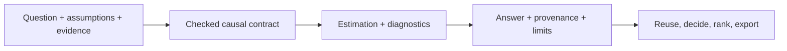

# Antecedent

[](https://github.com/iridae-dev/antecedent/actions/workflows/ci.yml) [](https://crates.io/crates/antecedent) [](https://pypi.org/project/antecedent/) [](https://github.com/iridae-dev/antecedent/releases/latest) [](https://doi.org/10.5281/zenodo.21556247)

**Antecedent is a causal inference compiler for Python and Rust.** Declare a causal question, a graph or study design, and the available evidence. Antecedent checks whether those declarations support the question, executes a compatible estimator, and returns an answer with its assumptions, diagnostics, uncertainty, limits and provenance attached.

Those declarations stay with the result when you reuse an analysis, make a decision, rank a study, or export an artifact for another system to consume.



See the [2.4.0 release notes](docs/release-notes/v2.4.0.md) for the changes from 2.3.0. The last tagged release is [2.3.0](docs/release-notes/v2.3.0.md).

## Install

Install for Python **3.11 or later**:

```bash
python -m pip install --upgrade antecedent
```

Install for Rust **1.85 or later**:

```bash
cargo add antecedent
```

The [contributing guide](CONTRIBUTING.md) covers source builds, the repository toolchain and development conventions. The Python installation includes NumPy and the CPU-native neural nuisance learner; optional Rust learner features are described in the [capability guide](docs/capabilities.md).

## Run an analysis

This example simulates a randomized treatment with an effect of two outcome units:

```python
import numpy as np
import antecedent as ant

rng = np.random.default_rng(17)
z = rng.normal(size=160)
treatment = rng.binomial(1, 0.5, size=160).astype(float)
data = {
    "treatment": treatment,
    "outcome": 2 * treatment + z + rng.normal(size=160),
    "z": z,
}
graph = [("treatment", "outcome"), ("z", "outcome")]
query = ant.AverageEffect("treatment", "outcome")

result = ant.analyze(data, graph=graph, query=query, seed=19, bootstrap=25)
print("Answer:", result.answer.kind, result.answer.value)
print("Calibration:", result.calibration.status)
report = result.inspect().to_dict()
print("Identification:", report["identification"]["summary"])

# Reuse the same question, graph and settings with a new data snapshot.
new_data = {**data, "outcome": data["outcome"] + treatment}
updated = result.study.refresh(new_data)
print("Updated effect:", updated.answer.value)

# Export the scientific result and inspect the consumer's acceptance report.
loaded = ant.load(result.export())
print("Artifact acceptance:", loaded.acceptance.status)
```

The estimate should be close to two, and the updated estimate one unit larger. The small bootstrap budget keeps the example quick; read the calibration status before treating an interval as measured. A successful analysis checks compatibility with your declared assumptions, not whether those assumptions are true. Loading restores the result and its acceptance report, not a live study or its dataset.

Continue with the [Python workflow](docs/python-workflow.md), [Rust quickstart](docs/rust-quickstart.md), or [worked examples](examples/README.md). From a source checkout, the Rust example runs with:

```bash
cargo run -p antecedent --example ate_quickstart
```

## What you can do

| Task | Where to start |
| --- | --- |
| Identify and estimate effects from a declared graph | [Supported analyses](docs/supported-analyses.md), [Python options](docs/python-options.md) |
| Analyze randomized experiments, policies, quasi-experiments, survival or longitudinal regimes | [Examples](docs/examples.md), [design-family support](docs/graphless-support-matrix.md) |
| Fit learner-backed effects with fold-local nuisance models and overlap diagnostics | [Capabilities](docs/capabilities.md), [cluster-owned cross-fitting](docs/guides/clustered-dml.md) |
| Carry effects across populations or evaluate temporal and counterfactual questions | [Population, time and uncertainty](docs/population-time-uncertainty.md), [transport and counterfactuals](docs/transport-counterfactuals.md) |
| Turn a causal result or declared external evidence into a decision | [Result lifecycle](docs/lifecycle.md), [decisions](docs/decisions.md), [external evidence](docs/external-science.md) |
| Rank the next study by its declared objective, information value and cost | [Study ranking](docs/design-ranking.md) |
| Recalculate supported parts of an analysis and inspect what was reused | [Selective recalculation](docs/recalculation-capabilities.md) |
| Examine sensitivity, structural scenarios and composed results | [Sensitivity and robustness](docs/sensitivity-and-robustness.md), [composition](docs/composition.md) |

The [support matrix](docs/support-matrix.md) defines the supported combinations of question, graph, evidence and inference method. The [capability inventory](docs/capabilities.md) describes available components; each workflow has its own requirements and limits.

## New in 2.3.0

- **Analysis to decision to study planning.** Checked handoffs preserve scientific quantities, units, support and original source evidence. Typed study-ranking objectives include structural sufficiency, information and decision value, with a checked Bayesian prior-to-signal adapter.
- **Reusable results and selective recalculation.** Supported estimation, response, transport, Bayesian, temporal and design workflows retain compatible state. Execution receipts show which work ran and which results were reused.
- **Measured uncertainty for five additional families.** Joint Bayesian transport, learned joint transport, nested-Markov Bayesian and Fisher inference, dependent temporal intervals, and sampled observation recovery expose method-specific scalar intervals at their validated protocols. Independent consumers replay the original source and check the expected identity.
- **External evidence and composition.** Finite responses, aligned outcome laws and bounded mean callbacks carry their provider identities and declared trust into supported decisions and artifacts.

Read the [release notes](docs/release-notes/v2.3.0.md) for exact scopes and refusals, the [API naming dictionary](docs/api_naming.md) for entry points, and the [changelog](CHANGELOG.md) for earlier releases.

## Read the claim, not just the number

Antecedent keeps identification, empirical support and uncertainty separate:

- The graph, design and evidence determine whether the causal question is identified. More observations cannot repair a missing causal assumption.
- Diagnostics describe the observed data and estimator fit. Passing diagnostics does not prove the causal model.
- Calibration applies to a named method and execution scope. In `result.calibration`, `calibrated` means a coverage record matches the execution, the execution is inside that record's scope, and <!-- generated:claim:calibrated_slot_means_a_current_matching_record:begin -->the record still attests the current code.<!-- generated:claim:calibrated_slot_means_a_current_matching_record:end --> An implemented interval is not automatically calibrated.
- Structural and sensitivity ranges describe variation over declared assumptions. They are not sampling confidence intervals. CATE predictions likewise do not imply pointwise confidence intervals.
- Exported artifacts retain identities and provenance. Their acceptance reports distinguish what an independent consumer verified from what remains declared or cannot be replayed.

Support does not imply measured coverage. The [support matrix](docs/support-matrix.md) lists each licensed cell and whether its estimator has a coverage measurement.

Unsupported combinations refuse with a reason or return an explicitly partial or unavailable answer. See [guarantees and support](docs/guarantees.md) and [refusals](docs/refusal-and-partial-knowledge.md) for how to interpret those outcomes.

## Documentation and contribution

Start at the [documentation index](docs/index.md) for the system model, workflow guides and API references. To contribute, read [CONTRIBUTING.md](CONTRIBUTING.md); commits require a Developer Certificate of Origin sign-off.

## License

MIT OR Apache-2.0 — see [LICENSE-MIT](LICENSE-MIT) and [LICENSE-APACHE](LICENSE-APACHE).
