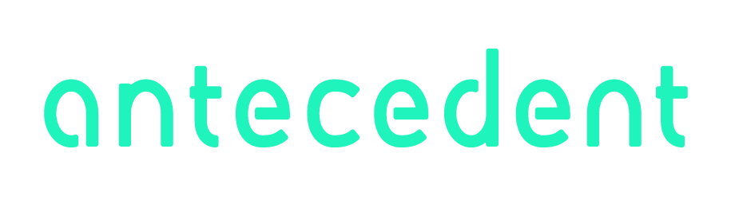

[](https://github.com/iridae-dev/antecedent/actions/workflows/ci.yml) [](https://crates.io/crates/antecedent) [](https://pypi.org/project/antecedent/) [](https://github.com/iridae-dev/antecedent/releases/latest) [](https://doi.org/10.5281/zenodo.21556247)



**Antecedent is a compiler and evidence-aware runtime for causal science**, for Rust and Python.

You declare a causal question, a causal graph or study design, and the data. Antecedent checks whether those declarations identify the quantity you asked for, compiles an analysis you can inspect before anything is fitted, and executes it. The answer comes back with its identification, assumptions, uncertainty, calibration status and the published methods behind it. A question the declarations cannot answer returns a typed refusal that names what is missing, not a number.

It covers effect estimation from observational and experimental data, causal discovery, structural causal models and counterfactuals, study designs (panel, discontinuity, survival, sequential regimes, interference), transport to other populations, and decisions and study planning built on those answers. It is written for researchers who need to know what an analysis established, and for engineers and autonomous software that need the same information in machine-readable form.

## Install and use Antecedent

Python **3.11+**:

```bash
python -m pip install --upgrade antecedent
```

Rust **1.97+**:

```bash
cargo add antecedent
```

[Installation](docs/start/installation.md) covers optional Rust learners, notebooks and source builds.

The example below simulates a randomized treatment whose effect on the outcome is two units, so the estimate can be checked against a known truth. It prepares the analysis, inspects the plan, estimates the effect, repeats the analysis on changed data, and exports the result.

```python
import numpy as np
import antecedent as ant

rng = np.random.default_rng(17)
z = rng.normal(size=160)
treatment = rng.binomial(1, 0.5, size=160).astype(float)
data = {
    "treatment": treatment,
    "outcome": 2 * treatment + z + rng.normal(size=160),
    "z": z,
}
graph = [("treatment", "outcome"), ("z", "outcome")]
query = ant.AverageEffect("treatment", "outcome")

# Prepare: declare the question and check what it needs. Nothing is fitted yet.
study = ant.prepare(
    ant.data.table(data), graph=graph, query=query,
    inference=ant.Frequentist(bootstrap=25),
    execution=ant.Execution(seed=19),
)

# Inspect the compiled analysis before running it.
print(study.inspect())

# Execute, then read the answer with its uncertainty and identification.
result = ant.estimate(study)
print("Answer:", result.answer.kind, result.answer.value)
print("Uncertainty:", result.uncertainty.summary)
report = result.inspect().to_dict()
print("Identification:", report["identification"]["summary"])
for citation in result.citations():  # the published methods behind this answer
    print("Method:", citation.reference)
assert abs(result.answer.value - 2) < 0.5  # the simulated truth is 2

# Rebind: a new branch on changed observations. The earlier result is unchanged.
new_data = {**data, "outcome": data["outcome"] + treatment}
updated_study = ant.rebind(study, data=new_data)
updated = ant.estimate(updated_study)
print("Updated effect:", updated.answer.value)  # one unit larger

# Export the result and load it with an explicit expectation.
artifact = result.export()
loaded = ant.load(artifact, expected=artifact.expectation)
print("Artifact acceptance:", loaded.acceptance.status)
```

The estimate lands near two, and the updated branch is one unit larger. The result names the published methods its route implemented, with any documented deviations, so its citations travel with the number. The bootstrap budget is small so the example runs quickly; read `result.inspect().calibration` before relying on interval coverage.

Continue with the [first analysis](docs/start/first-analysis.md), which also shows the Rust form, and [how to read a result](docs/start/reading-a-result.md).

## Tutorials and guides

Each tutorial follows one scientific task from declaration to what the computation established, and pairs with a maintained [example](examples/README.md). Start with the [observational study](docs/tutorials/observational-study.md).

| Tutorial | What you do |
| --- | --- |
| [One feedback system, three questions](docs/tutorials/feedback-three-questions.md) | Observe a variable, fix it and shock its disturbance in a model with feedback. Each is evaluated as its own world, and an unsolvable intervention stays visible as failed mass. |
| [Compare a coordinated intervention program](docs/tutorials/joint-interventions.md) | Compare a program with its baseline using uncertainty from the shared fit, and separate a model that can compute a program from a design that identifies its effect. |
| [Beyond the marketing mix](docs/tutorials/beyond-marketing-mix.md) | Carry a geographic marketing model through spending proposals, experimental evidence, a business decision and the next study. |
| [The smallest defensible test](docs/tutorials/synthetic-users-launch.md) | Combine historical human behavior, a large agent dataset and a small human pilot to support a launch decision; when predictions fail, choose a targeted follow-up. |
| [Write and replay causal policies](docs/tutorials/programmable-policies.md) | Compare fixed, conditional and history-dependent pricing and inventory rules; replay the same stores, verify portable programs and recover custom callbacks. |
| [From day zero to publication](docs/tutorials/research-from-day-zero.md) | Plan an HCI study, choose a targeted follow-up, audit the paper's claims against its designs, outcomes and evidence, and cite the methods behind every number. |
| [From a new experiment to the next study](docs/tutorials/experiment-to-next-study.md) | Map experimental evidence into a retained response law, see the response and the decision change, and rank further studies by information value and cost, without treating the result as identified. |
| [Stop, continue or run longer](docs/tutorials/decide-under-uncertainty.md) | Decide when p = 0.07: a retailer's experiment, a decision contract and the value of more evidence. |
| [Choose a discount when the cost of a return is a range](docs/tutorials/decide-across-trade-offs.md) | Decide with a trade-off stated as a range, read where the choice switches, and optionally narrow the range from past decisions. |
| [Choose an email frequency when the cost of an unsubscribe is a range](docs/tutorials/email-frequency.md) | Decide a sending frequency from the arm means of a three-arm experiment when the cost of an unsubscribe is a range. |
| [Replay and current decisions](docs/tutorials/replay-and-current-decisions.md) | Change a utility without refitting, export a decision, then withdraw a source: historical replay remains possible while current decision use refuses. |
| [Estimate an effect from observational data](docs/tutorials/observational-study.md) | Analyze a real public dataset end to end. |
| [Use your own outcome and treatment models](docs/tutorials/external-learners.md) | Fit an average effect with a scikit-learn-compatible model or an in-context model. |
| [When the comparison group does not overlap](docs/tutorials/when-overlap-fails.md) | Follow a refusal when the comparison group does not overlap. |
| [When the causal assumptions stop holding](docs/tutorials/when-assumptions-change.md) | Decide what to do when new data stop fitting the graph behind an estimate. |
| [Use an analysis inside an application](docs/tutorials/application-component.md) | Run a scientific component inside an application. |
| [When outside events interrupt a launch](docs/tutorials/event-driven-launch.md) | Forecast clustered announcements with a fitted Hawkes model, compare launch actions under the same simulated arrivals, and value an extra hour of observation before deciding. |

The [guides](docs/index.md#guides) are organized by the question you have: data and inputs, estimating effects, experiments and study designs, discovery, structural models, transport, decisions and study planning.

**Building causally-aware software and better scientific agents?** Embed causal workflows with inspectable plans and machine-readable assumptions, uncertainty and limits. Antecedent supplies the causal computation and its contracts; your application supplies planning, tool use, permissions and the policy for acting on an answer. The minimal [reference host](examples/rust/reference_host.rs) ([Python](examples/python/reference_host.py)) contains no agent logic. Start with the [application component tutorial](docs/tutorials/application-component.md) and [embedding Antecedent](docs/guides/build/embedding.md).

## What backs a supported capability?

**Antecedent's own development applies high-assurance engineering principles, with explicit evidence governing capability claims.** Capability claims are tied to executing tests, and four kinds of evidence are kept separate:

- **Provenance** names source methods, implementation exposure and deviations that limit published guarantees, and says which published conclusions transfer. Every result carries the records behind the route it executed, so its citations and documented deviations travel with it; see [citing the methods behind a study](docs/guides/citing-a-study.md).
- **Independent checks** compare a named proposition with analytic truth, an independently constructed fixture or a pinned external implementation. Internal consistency and frozen outputs are labelled separately, and a component comparison establishes that component's behavior.
- **Support** is decided by one rule: a scientific combination is supported when it has a provenance record plus an executed independent check. The combination is a [support-matrix](docs/support-matrix.md) cell naming the question, structure, evidence, inference and estimator, a [design-family](docs/graphless-support-matrix.md) row, or a capability outside the matrix (transport stages, adaptive procedures, decisions, bridges). A route outside a supported unit refuses in a release build with `not_supported`, a detail and the missing evidence; a development build runs it and records `would_refuse` on the result. Scientific refusals (not identified, typed n/a, invalid input) refuse in every build. Successful execution never upgrades the scientific claim.
- **Calibration** records the uncertainty construction, tested setting, sample sizes, coverage and Monte Carlo error. Its status (`calibrated`, `outside_measured_scope`, `measured_below_nominal`, `not_measured`) is attached to every reported interval and, at run time, never refuses or gates a route. A result is `calibrated` only when a matching record applies; <!-- generated:claim:calibrated_slot_means_a_current_matching_record:begin -->the record still attests the current code.<!-- generated:claim:calibrated_slot_means_a_current_matching_record:end --> Implemented intervals are not automatically calibrated.

Read a result's identification, support, uncertainty and calibration separately. [Assurance](docs/concepts/assurance.md) defines these terms, with [results are claims](docs/concepts/results-are-claims.md), [uncertainty](docs/concepts/uncertainty.md) and [refusals](docs/concepts/refusals.md). The [support matrix](docs/support-matrix.md) separates supported combinations from coverage measurements.

[How Antecedent checks its scientific methods](docs/guides/scientific-verification.md) gives the [full evidence model](docs/guides/scientific-verification.md#the-evidence-model), including how supported units are counted and how to make a development build. It follows AIPW from its source method through an independent numerical reference, executing assertions and calibration requirements, and shows how two mathematical derivations check arrow strength and how reviews stay attached to the code they examined. [Provenance](provenance/README.md) and the [evidence rules](parity/README.md) hold the records.

## Release, migration and contribution

- [Release notes for 3.1.0](docs/release-notes/v3.1.0.md) describe what is new. [Release notes for 3.0.0](docs/release-notes/v3.0.0.md) describe what changed in the 3.0 claims.
- The [migration guide](docs/migration.md) gives the exact old and new forms from 2.4 to 3.0.
- [Migrate from 3.0 to 3.1](docs/migration-3.1.md) covers compiled declarations, study resume, and the refusals a 3.1 caller reads.
- The [documentation home](docs/index.md) covers tutorials, guides, concepts and reference. The [roadmap](ROADMAP.md) describes future work.
- See [CONTRIBUTING.md](CONTRIBUTING.md) to contribute; commits require Developer Certificate of Origin sign-off.

## License

MIT OR Apache-2.0 — see [LICENSE-MIT](LICENSE-MIT) and [LICENSE-APACHE](LICENSE-APACHE).
