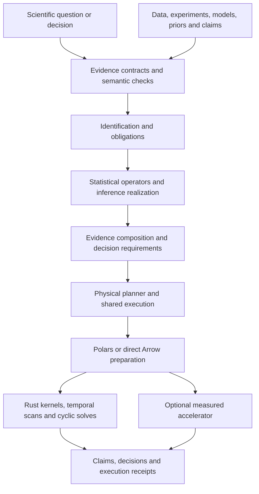

# Antecedent 3.0 plan

Consolidated planning proposal · 14 October 2026 · joint-response scope amendment 18 October 2026

## Product outcome

**Antecedent 3.0 should be one causal compiler: a system that realizes scientific questions across static and temporal settings, frequentist and Bayesian inference, feedback models, and mixed evidence—and calculates only the work a user's analysis or decision requires.**

The product ambition is:

> If you can do it static, you can do it temporal. If you can do it frequentist, you can do it Bayesian. Compatible results can become evidence for decisions, further analyses, and experiments.

Make that ambition an architecture and capability-completion requirement. A feature should become a scientific target with reusable operators and checked inference realizations, rather than another set of independently wired route variants. Parity means equivalent target semantics, appropriate uncertainty, useful composition, and consistent lifecycle behavior; it does not mean identical estimators or numbers.

Antecedent 3.0 should support composable, jointly evaluated intervention-response functionals over fitted dynamic mechanisms. Those functionals remain available to uncertainty-aware decision evaluation and, where supported, intervention-program search. Use the Google Meridian comparison as a test of this general architecture, without introducing a separate MMM workstream or `antecedent.marketing` product surface.

The same compiler should make Antecedent substantially faster and capable of larger workloads. It should avoid unnecessary reads, copies, fits, tests, draws, and retained outputs; choose bounded-memory algorithms; coordinate hardware; and explain the resulting plan. Polars, SIMD, threading, and GPU are physical tools within that design.

This document consolidates the performance, cyclic-model, and unified-compiler analyses. The conditional accelerator work currently listed under **2.5** in the repository roadmap is incorporated here into the **3.0 performance workstream**. Its promotion gates remain conditional; GPU availability does not block the CPU, compiler, or scientific capability work.

## Principal decisions

1. **Deepen the existing compiler.** Retain `PreparedStudy` / Python `PreparedAnalysis`, immutable causal contracts, domain-separated identities, and `antecedent-expr`. Add internal statistical, evidence/decision, and physical operators behind the existing workflow.
2. **Make counterpart completion explicit.** Every advertised family needs its meaningful static/temporal and frequentist/Bayesian realizations, uncertainty outputs, decision handoffs, validation, and replay. Separate engineering omissions from new-method and identification research.
3. **Use Rust Polars as the leading lazy preparation candidate.** Keep Antecedent-owned data contracts, Arrow-compatible chunks, and direct typed numerical paths. Promote Polars through representative integration gates.
4. **Remove avoidable memory growth before broad acceleration.** Bound bootstrap index retention, eliminate repeated packing/copies, lower eligible models to stable sufficient statistics, and plan actual concurrent/output memory.
5. **Add genuine cyclic semantics.** Preserve reciprocal directed edges, explicit intervention/solution contracts, and simultaneous block execution. Start with specified linear equilibrium models and scoped experimental identification.
6. **Standardize evidence meaning, not one payload.** Preserve points, confidence regions, covariances, sampling laws, posteriors, predictive laws, sets, and scenarios. Compose them through declared adapters and dependence rules.
7. **Plan backward from decisions.** Request only the means, covariance, law, coupling, or future-data model that the decision functional requires.
8. **Earn acceleration and public claims.** Measure complete equivalent workloads, including uncertainty, diagnostics, transfers, ordering, memory, and failures. Keep exact optimization, valid reuse, and explicit approximation separate.

9. **Fit and query joint dynamic response systems.** Extend the existing target, temporal, inference, evidence, and decision operators with X01–X06 below. A programmable intervention over a fitted model does not establish that its mechanism was estimated with uncertainty adequate for a new causal claim.

10. **Adapt the plan when an attempt fails.** The end-state above stays fixed. A failed approach, an early refusal, or a missed measurement closes that attempt and names the next way to reach the same end-state. This covers identification, counterpart families, data preparation, performance and capacity, feedback, evidence composition, and acceleration. A public claim is adjusted only after the named attempts are exhausted, and the failed attempts stay on the record. A compiler guard still rejects an illegal operation; the caller uses a legal representation of the same request.

## Release scope and gates

| Commitment | Proposed 3.0 scope | Gate |
| --- | --- | --- |
| Unified compiler and parity | Complete meaningful counterparts and handoffs for the families explicitly advertised as covered by 3.0. | Executing user workflows, scientific evidence, and lifecycle tests; a larger enum or support matrix is insufficient. |
| Performance and capacity | Faster complete workloads, efficient prepared/batch reuse, 10× row capacity on named lanes, and one exact 100× capacity demonstration. | Frozen controls, fixed resource/time envelopes, equivalent scientific work, and published measurements. |
| Feedback | Native cyclic graph/model representation, specified linear equilibrium interventions, at least one experiment-identified linear route, explicit delayed-feedback semantics, and validated σ-separation foundations. | Named model/query/inference licenses, solution checks, independent truths, and artifacts. |
| Joint response core | X01 typed joint intervention-response contracts and X06 scope/evidence suite; the bounded X02 family, with joint Δ_AB licensed only for worlds an identification attempt has earned. | Whole-contrast inference, a recorded sequence of failed and following attempts, independent artifacts, and explicit comparison scope; no unconditional MMM-feature-parity claim. |
| Joint response extensions | X03 time-varying mechanisms, X04 intervention-program search, and X05 experiment-to-decision closure, each attempted on the fitted interface. | A failed attempt names the next attempt. The public claim is adjusted after the named attempts are exhausted. |
| Accelerator | One optional backend/platform if the whole neural crossfit workload clears the promotion gate. | All six carried-over roadmap gates, including packaging and CPU consumption. |
| Broader cyclic systems (promoted 20 October 2026) | Y18 cyclic ID/FCI and all Y19 families: nonlinear equilibrium, solution sets/selection, counterfactuals, ODE/OU and equation/constraint systems; modeling, fitting, discovery, identification. | Mandatory implementation workflows with theorem/correctness tests, Python, resource, compiler and artifact acceptance. Calibration/attestation are separate and do not block Y18/Y19 closure. |
| Advanced research | Automatic estimator generation and extensions beyond named production families. | Separate validation. |

Parity is not a promise that every estimator automatically accepts every graph, intervention, or uncertainty object. A meaningful counterpart may need a different statistical method or additional premises. Engineering gaps remain unfinished work; genuinely different or unidentified targets require an explicit scientific boundary. New cyclic families do not inherit all acyclic licenses merely because they share operators.

The operator architecture and the universal product promise have different completion gates. Selected vertical slices establish the architecture. The broad public promise requires counterpart and decision-handoff completion across the advertised family scope.

## Baseline and existing foundations

Antecedent already performs heavy computation in Rust, has immutable columnar data, releases the GIL on native paths, caches prepared identification, shares compatible nuisance fits and designs, supports score retargeting, and has bounded incremental state. It also has identified-functional IR, scientific ports, evidence lineage, decision requirements, and independent artifact consumers. Extend these rather than introducing parallel workflows. [Architecture](/Users/charleshinshaw/Desktop/antecedent/docs/architecture.md), [compiler decision](/Users/charleshinshaw/Desktop/antecedent/adr/0022-causal-compiler-contract.md:38).

| Observed starting point | Consequence for 3.0 | Evidence |
| --- | --- | --- |
| `ExprNode` already represents distributions, kernels, products, marginalization, integration, expectation, and contrast. | Keep this identified-functional IR and add statistical/operator lowering around it. | [lib.rs](/Users/charleshinshaw/Desktop/antecedent/crates/antecedent-expr/src/lib.rs:238) |
| `FunctionalProgram` validates immutable structure and factor requirements. | Structural validity is distinct from identification and inferential guarantees. | [program.rs](/Users/charleshinshaw/Desktop/antecedent/crates/antecedent-expr/src/program.rs:123) |
| Logical planning is largely route/query/split metadata; physical planning assumes roughly eight f64 columns and reports no chunked path above its soft limit. | Build executable multi-operator plans with actual design widths, alternative algorithms, and resource estimates. | [plan.rs](/Users/charleshinshaw/Desktop/antecedent/crates/antecedent/src/planner/plan.rs:149) |
| Bootstrap allocates all `n × B` u32 sample indices before evaluation. | Remove O(nB) index retention, including before adaptive stopping. | [util.rs](/Users/charleshinshaw/Desktop/antecedent/crates/antecedent-estimate/src/util.rs:364) |
| Ingestion, selection, dense design, and solver preparation can each copy full data. | Optimize the complete materialization chain, not just the Python boundary. | [ingest](/Users/charleshinshaw/Desktop/antecedent/python/src/lib.rs:2493), [design](/Users/charleshinshaw/Desktop/antecedent/crates/antecedent-stats/src/design.rs:306), [faer adapter](/Users/charleshinshaw/Desktop/antecedent/crates/antecedent-stats/src/faer_backend.rs:36) |
| Gaussian posterior gradients repeatedly scan observations. | Compile eligible fixed likelihoods to stable sufficient-statistics targets. | [gaussian_target.rs](/Users/charleshinshaw/Desktop/antecedent/crates/antecedent-prob/src/gaussian_target.rs:29) |
| Portable optimized kernels exist; architecture-specific SIMD is explicitly unavailable. | Inspect generated code and measure targeted dispatch. | [execution.rs](/Users/charleshinshaw/Desktop/antecedent/crates/antecedent-core/src/execution.rs:95) |
| Outer parallelism is bounded on shared helpers, but faer convenience calls use global parallelism. | Carry per-operation thread policy into numerical backends. | [map_indexed](/Users/charleshinshaw/Desktop/antecedent/crates/antecedent-core/src/execution.rs:726), [faer call](/Users/charleshinshaw/Desktop/antecedent/crates/antecedent-stats/src/faer_backend.rs:50) |
| Current Burn learner is CPU `NdArray<f32>`; training holds a global-RNG lock. | An accelerator is a new backend and runtime design, not a switch already available. | [Burn adapter](/Users/charleshinshaw/Desktop/antecedent/crates/antecedent-learn-burn/src/lib.rs:4) |
| Ledger synthesis and scientific bridges have point-only boundaries; composed uncertainty is restricted. | Propagating mapping uncertainty, intervals, and posteriors is substantive scientific work. | [ledger](/Users/charleshinshaw/Desktop/antecedent/docs/evidence-ledger.md:9), [bridges](/Users/charleshinshaw/Desktop/antecedent/docs/scientific-bridges.md:12) |
| Existing static/temporal graph classes and compiled models prohibit same-time directed cycles. | Introduce a distinct cyclic family and guard DAG-only rules. | [graph classes](/Users/charleshinshaw/Desktop/antecedent/crates/antecedent/src/accepted.rs:163), [model compile](/Users/charleshinshaw/Desktop/antecedent/crates/antecedent-model/src/compile.rs:476) |

The active 2.4 tree's matrix has 4,320 coordinates: 717 licensed, 1,809 n/a, and 1,794 refused. These are query/graph/structure/inference/validation combinations, not feature counts or a coverage percentage. Licensing does not imply interval calibration. Current n/a classifications describe today's coordinate vocabulary, not every possible future scientific formulation. [Support matrix](/Users/charleshinshaw/Desktop/antecedent/docs/support-matrix.md:17).

The observations and route counts above are historical 2.4-era snapshots, not a final 2.4.1 inventory. B01/B02 must archive and enumerate the final published 2.4.1 state once available, including programmable interventions and mechanism selection, and distinguish existing execution from missing fitting/inference work. Preserve 2.4.0 as a historical control. If 2.4.1 is not yet published, mark the predecessor control provisional and reconcile it before B05 freezes scope or release gains are measured.

Freeze final predecessor revisions, dependencies, host/resource configurations, and representative workloads before implementation comparisons. Use final published 2.4.1 for the B06/B08 predecessor comparisons once available; historical timings and the active working tree are not interchangeable controls.

## Shared compiler architecture

### Represent the whole computation

| Layer | Meaning and responsibility |
| --- | --- |
| Scientific problem | Population, units, variables, interventions/policies, outcome functional, time/horizon, structural assumptions, evidence, and decision objective. |
| Identification product | Identified functional or set, proof/derivation, required evidence, unresolved obligations, and search status. |
| Statistical program | Models, nuisance fits, scores or likelihood/loss, priors, folds, resampling, posterior computation, diagnostics, and error guarantees. |
| Evidence and decision program | Source contributions, transformations, dependence, joint uncertainty, actions, utility, constraints, and information value. |
| Physical plan | Scans, projections, layouts, materialization, batching, kernels, CPU/GPU, threads, RAM/VRAM/spill, cancellation, and retained state. |
| Claim and execution receipt | Answer, uncertainty interpretation, support/calibration, assumptions, identities, provenance, and measured execution facts. |



These are compiler ownership boundaries, not necessarily new crates or public classes. Keep `PreparedStudy` / `PreparedAnalysis` as the practitioner workflow and `antecedent-expr` as the identified-functional IR. The mechanism/equation and simultaneous-block plans are internal companions. Cheap preflight remains separate from identification, fitting, enumeration, and simulation.

Keep three graphs distinct: the **causal graph** of mechanisms/interventions, the **evidence graph** of provenance/dependence/selection, and the **execution graph** of computation. Causal feedback lowers to explicit scan/solve operators. Provenance cannot recursively validate itself, and algorithmic iterations need explicit convergence/resource policies. A probabilistic factor graph can have loops without giving those loops the same meaning as causal feedback.

### Make operator contracts and rewrites executable

Each operator declares scientific input/output types, model assumptions, evidence-use effects, uncertainty requirements, numerical capabilities, retained state, resource needs, and dependency/reuse rules. Relevant effects include reading observations, selecting a policy, fitting a nuisance model, using a data-derived prior, conditioning, intervening, transporting, and reusing a frozen fit.

Legal rewrites include required-column projection, declared filter pushdown, shared row/design preparation, certified nuisance reuse, sufficient-statistics lowering, batched intervention/draw evaluation, dependency-based recalculation, and memory-aware scheduling. Conditions must preserve target population, sample selection, history, dependence, uncertainty, and scientific obligations.

Generate support/test obligations from checked recipes while retaining explicit scientific licenses. Compatible types do not alone establish valid causal composition or calibrated uncertainty. MLIR's legality-based lowering and Gen's capability-based inference interfaces are useful precedents, not mandatory dependencies. [MLIR conversion](https://mlir.llvm.org/docs/DialectConversion/), [Gen interface](https://www.gen.dev/docs/stable/ref/core/gfi/).

## Static and temporal parity

Use one language of observation units, histories, actions, conditional mechanisms, and outcome functionals. A static analysis is a one-decision-time specialization. Longitudinal analysis repeats transitions, interventions, integration, and reduction over explicit history and horizon. Under matching data/design/assumptions, a horizon-one specialization should reproduce its static counterpart.

Temporalization supplies treatment timing, history-adapted policy, sequential exchangeability where required, positivity over histories, treatment-affected confounders, censoring, initial-state law, and observation cadence. An added time column supplies none of those. Longitudinal TMLE illustrates the causal target → functional → estimator separation within its independent-subject-trajectory setting. [Chaffee and van der Laan 2012](https://pubmed.ncbi.nlm.nih.gov/22740582/).

Independent subject trajectories, clustered panels, and a single dependent series need distinct splitting, resampling, and inference contracts. Policies and prospective features use information available at their action/prediction time. Retrospective nuisance fitting can legitimately use later outcomes in training subjects when the method permits it; prevent held-out/evaluation leakage and require forward-only training only where the method or deployment setting demands it.

Factor history construction, lag alignment, policy evaluation, transition, sequential regression/integration, assignment/censoring weighting, and trajectory reduction into operators. Preserve common-calendar block coupling across mechanisms/horizons where required. Current temporal response already implements aligned block resampling on named routes. [Temporal bootstrap](/Users/charleshinshaw/Desktop/antecedent/crates/antecedent-estimate/src/temporal_response/bootstrap.rs:57).

Do not infer stationarity from a temporal type. A period change can alter population, assignment, mechanism, support, or measurement. Finite-horizon, stationary, and equilibrium targets stay distinct. Existing temporal graphs represent lagged feedback, but finite-window backdoor certification can fail when relevant ancestry continues indefinitely; increasing the history cap is not a general cure. Preserve the narrow existing single-step Pulse fallback and research explicit history/state/sequential extensions. [History boundary](/Users/charleshinshaw/Desktop/antecedent/crates/antecedent-identify/src/temporal_window.rs:110), [Pulse scope](/Users/charleshinshaw/Desktop/antecedent/crates/antecedent-identify/src/temporal_backdoor.rs:248).

## Frequentist and Bayesian parity

The causal target should be independent of inference selection. Reuse design compilation, conditional-model kernels, sufficient statistics, functional evaluation, derivatives, and execution. Choose a valid inference realization and record any extra assumptions.

| Realization | Required ingredients | Output meaning |
| --- | --- | --- |
| Frequentist model/likelihood | Statistical model, estimator, sampling design, uncertainty method | Estimate, covariance/score or sampling law, with confidence/calibration scope |
| Frequentist orthogonal/semiparametric | Identified functional, nuisances, score, cross-fitting, regularity | Estimate and valid influence/covariance/resampling object |
| Bayesian generative | Likelihood, prior, dependence/latent model, posterior algorithm | Parameter/functional posterior; predictive law only when generated |
| Generalized Bayesian | Declared loss, prior, learning rate/temperature, calibration policy | Generalized posterior with distinct interpretation |
| Partial identification/structural envelope | Identified set/class and supported estimation uncertainty | Bound, set, envelope, or model-indexed answers; probabilities only when justified |

Frequentist AIPW and Bayesian g-computation may realize the same estimand with different estimators. Bayesian efficiency and frequentist coverage need appropriate prior and regularity conditions. Generalized Bayes supplies a principled loss-based option, with explicit learning rate and calibration. Neither is a universal posterior wrapper around arbitrary predictions. [Ray and van der Vaart 2020](https://arxiv.org/abs/1808.04246), [Bissiri, Holmes and Walker 2016](https://arxiv.org/abs/1306.6430).

A prior can narrow an unidentified target without establishing identification from the observations. Additional identifying restrictions create a separate assumption branch; preserve their sensitivity and their effect on scientific identity. Current tempered temporal inference must retain its generalized-posterior meaning.

Inference providers declare conditional density/sampling, differentiable log density, estimating equations, influence contributions, posterior updating, predictive simulation, exact integration, or state transitions. Keep `antecedent-learn` as prediction machinery. Select inference per coherent statistical component, retaining a convenient study default; do not force a mixed workflow to relabel every source as Bayesian or frequentist.

Start with named linear/Gaussian, finite discrete, GLM, g-computation, and orthogonal-score recipes. Expand automatic estimator compilation within verified classes. Identification-to-estimation methods for hidden-variable DAGs and autoDML's smooth-functional construction are research foundations with explicit scope, not proof of a universal efficient-estimator generator. [Bhattacharya, Nabi and Shpitser 2022](https://www.jmlr.org/papers/v23/20-296.html), [autoDML, revised 2026](https://arxiv.org/abs/2501.11868).

## Evidence composition and decisions

### Standardize the envelope and preserve the representation

Every source binds quantity, units, population, regime/intervention, horizon, conditioning, structural premises, observation/lineage identity, selection/training history, support, and calibration. Preserve parameter, sampling, predictive, structural, identification, mechanism, measurement, and Monte Carlo uncertainty separately.

| Evidence representation | Useful contribution | Required boundary |
| --- | --- | --- |
| Point/mean | Affine utility and nominal comparison | Not a complete uncertainty law |
| Covariance/influence contributions | Linear propagation and supported joint frequentist inference | Include cross terms and sampling units |
| Confidence region/band | Coverage-based or robust claims | Not posterior probability mass |
| Sampling/bootstrap law | Repeated-sampling approximation | Not automatically a belief over the true state |
| Parameter/functional posterior | Bayesian uncertainty and expected loss | Not individual outcome risk |
| Interventional/predictive law | Outcome thresholds, quantiles, predictive utility | Distinguish outcome variation from parameter uncertainty |
| Identified set/envelope | Robust/minimax/invariance analysis | No implicit probabilities |
| Likelihood/observation model | Supported probabilistic synthesis | Shared parameters, conditioning, dependence and prior origins explicit |
| Scenario/assumption range | Conditional decisions and sensitivity | Not empirical probability by declaration |

Keep pooling, borrowing/updating, causal transport, scientific bridges, reuse, repeated observation use, mixtures, marginalization, and envelopes as distinct operators. Shared observations, models, priors, parameters, noise, regions, or periods can couple results. Disjoint IDs prevent some double counting but do not prove every independence or transport premise. Use and extend the existing ledger before numerical combination. [Evidence ledger](/Users/charleshinshaw/Desktop/antecedent/docs/evidence-ledger.md:9), [propagation rule](/Users/charleshinshaw/Desktop/antecedent/crates/antecedent-contract/src/joint_law_rule.rs:713).

Mixed inference needs explicit adapters. A frequentist estimate/covariance can enter a justified summary observation model, with approximation, sampling/selection assumptions, dependence, and origin recorded. A confidence interval cannot become a posterior by renaming it. Shared probabilistic modules need parameter/prior reconciliation; full joint modeling, Markov melding, cut/semi-modular inference, and robust envelopes are distinct policies. [Markov melding](https://arxiv.org/abs/1607.06779), [modular generalized Bayes](https://arxiv.org/abs/2202.09968).

Extend bridge uncertainty in the mapping itself: measurement correction, surrogacy, transport, and horizon transformations may be uncertain and coupled to their sources. For nonlinear g, `g(E[X])` generally differs from `E[g(X)]`. Existing point-only bridges and composed-interval/posterior restrictions identify new validation work. [Scientific bridges](/Users/charleshinshaw/Desktop/antecedent/docs/scientific-bridges.md:12), [joint-law propagation](/Users/charleshinshaw/Desktop/antecedent/docs/joint-law-propagation.md:13).

Joint draws need a shared-law/alignment contract, not equal lengths. Distinguish bootstrap replicates, graph atoms, parameter draws, outcome draws, trajectories, and counterfactual worlds. Preserve unidentified/unevaluable mass; completion counts are not posterior weights. A posterior of mean responses across actions is not automatically a joint law of individual potential outcomes.

### Plan backward from the decision

| Decision request | Minimum representation | Planning effect |
| --- | --- | --- |
| Nominal affine expected utility | Compatible means | Avoid unnecessary predictive simulation |
| Variance of linear utility | Joint covariance or suitable joint law | Request cross terms |
| Probability of loss/quantile | Appropriate state or outcome law | Preserve epistemic versus predictive meaning |
| Nonlinear utility | Sufficient joint information or licensed bound | Never pair unrelated marginals by index |
| Expected regret/optimality probability | Appropriate coupling across action values | Ordinary expected-utility comparison still needs only expectations |
| Robust/minimax decision | Set/region/scenario with declared interpretation | Keep robust conclusions distinct from averages |
| EVSI | State belief, future-data model, update, actions and utility | Compile preposterior computation; net value additionally needs cost and utility conversion |

Current decision contracts already expose many of these requirements. Expand them into demand-based compiler planning. Return the smallest missing obligation and a supported weaker result when available. Information gain, narrower intervals, identification probability, and decision improvement remain different design objectives. [Decisions](/Users/charleshinshaw/Desktop/antecedent/docs/decisions.md:30), [design ranking](/Users/charleshinshaw/Desktop/antecedent/docs/design-ranking.md:14), [VoI reference](https://arxiv.org/abs/1703.08994).

A useful algebraic fixture: X and Y each take 0 or 2 with equal probability, and acting yields `XY−1` versus zero for not acting. Joint rows `(0,0),(2,2)` give expected acting utility +1; `(0,2),(2,0)` give −1. The marginals are identical. With only marginals, preserve a bound rather than inventing the coupling.

The flagship mixed workflow should combine a frequentist cluster trial, temporal period-specific effects, a Bayesian cost model, and a declared endpoint-to-margin map. Bind population, horizon, units, overlap, and transport first. Means can support a nominal affine value comparison. Profit probability or expected regret requires a suitable state/predictive joint model or a supported robust alternative. A new utility should cause zero causal fitting; a new period or prior should invalidate precisely the affected work. EVSI additionally requires what a future study observes and how the decision updates.

## Joint intervention responses and the Meridian design test

These six additions extend existing workstreams. The X IDs correspond to executable work in the development punchlist; they do not introduce a separate domain architecture. Their priority is X01, X02, X04, X03, X05, X06; their numbering preserves the proposal's identifiers.

| Addition | Existing integration points | Scope decision |
| --- | --- | --- |
| X01 — Joint interventional response functionals | C02, C05.1, T02, E08; P07, P08, P12 | Mandatory core target/world-alignment contracts and one complete joint contrast; other consumers open progressively with full method evidence. |
| X02 — Fittable nonlinear, history-dependent mechanisms | C04, D11, T05, T08, N09; P07, P11, P12 | Fit the bounded family. B04 closed the Gaussian-panel attempt at Δ_AB. Following attempts identify each world from a design with support there. Broader families stay separate. |
| X03 — Time-varying mechanism inference | T06, T10, P11, P13, E07 | Separately gated modeling increment; no dependency on Y feedback. |
| X04 — Optimization over intervention programs | E09, E10, E15, C11, L02; P17 | Finite-candidate search first. A missing certificate starts continuous search, which ships as best-found until it earns a certificate. |
| X05 — Experimental evidence-to-model-to-decision closure | E03–E07, E12; P09, P11, P16 | Translate the experiment into the longitudinal model. An unsupported mapping ships the weaker conditional result and continues the update-to-decision chain. |
| X06 — Joint-response reference and external acceptance suite | Q04, Q07–Q09, Q11 | Mandatory scope/evidence exercise and second flagship; full Meridian parity is not a release condition. |

### X01 — Treat a contrast of intervention worlds as one scientific target

Support typed contrasts over simultaneous static interventions, coordinated temporal programs, interactions, mediated responses under their own identification rules, and dose × time surfaces. For two interventions, a reference interaction is

\[
\Delta_{AB}=E[Y_{a,b}]-E[Y_{a,0}]-E[Y_{0,b}]+E[Y_{0,0}].
\]

Here `0` is an explicitly declared reference intervention, not an assumed universal absence of treatment. In temporal targets, `a` and `b` denote schedules or history-adapted programs with declared timing, horizon, and initial-state law. All worlds bind compatible populations, outcomes, units, conditioning, and reference regimes. Mediation additionally retains cross-world and path-specific premises; algebra alone does not license it.

Check identification and data support for every required world and for the assembled functional. Compile common preparation, fits, and evaluation once; retain covariance across world estimates or aligned posterior functional draws, including shared parameter, history, and mechanism uncertainty. Give the complete contrast its own uncertainty procedure, diagnostics, support, calibration, identity, and artifact. A convenient expression constructor or subtraction of independent marginal intervals is insufficient. Distinguish observationally identified claims from model-conditional simulations and unsupported extrapolation. The same contract should serve interacting drugs, industrial controls, pricing policies, and public interventions.

### X02 — Estimate the mechanism, including its uncertainty

Begin with one narrow parameterized family rather than arbitrary callbacks or a large model menu. A motivating grouped longitudinal system is

\[
Y_{g,t}=\alpha_g+s(t)+\sum_j f_j(A_j(X_{g,\le t}))
       +\sum_{j<k}h_{jk}(A_j,A_k)+\epsilon_{g,t}.
\]

Groups `g`, time `t`, baseline/seasonality `s(t)`, carryover transforms `A_j`, saturating responses `f_j`, and selected interactions `h_{jk}` require explicit parameter, observation, and causal assumptions. Provide constrained parameterized finite distributed-lag/carryover and saturation functions with checked derivatives, hierarchical or partially pooled effects across declared groups, and serial/group dependence. Specify a coherent likelihood or estimating-equation route and frequentist/Bayesian realizations where scientifically appropriate; distinguish missing counterparts from scientific boundaries.

The bounded production proposal is a finite-lag nonlinear response family on one named group/time design, with declared pooling and dependence, a joint two-intervention contrast, and appropriate inference. B03/B04 fixed the lag, saturation, interaction, pooling, and dependence. B04 closed one identification attempt: fitting that Gaussian panel, or simulating its curve, does not identify joint Δ_AB. The fit remains required. The next attempt identifies each of the four worlds from a design that has support there, and uses the fitted mechanism to carry parameter uncertainty inside those worlds. The first such design is an existing licensed linear or g-computation intervention route. An observational panel that leaves a world unsupported is followed by an experimental or quasi-experimental joint assignment. A world is reported as model-conditional only after those designs leave it unsupported. Parameter and mechanism-fit uncertainty must reach response surfaces, contrasts, and decisions. Reuse D11 views, T08 recipes, T05 dependence, and N09 tiling with shared draw identity instead of independent scenario materialization. This finite-history work does not require contemporaneous cyclic inference.

### X03 — Infer time-varying structural effectiveness

Once the parameterized mechanism interface is stable, attempt piecewise-constant parameters with identifiable change points. A weakly identified change point starts the next attempt: smoothly varying parameters with regularization or priors. Preserve uncertainty about changes, smoothing, and model selection. Use T06/T10 history, refresh, and drift contracts and P13 target-native validation.

Analyze which changes in an effectiveness or ROI functional are consistent with changed exposure, saturation, population/geographic composition, or structural mechanism. Any decomposition requires explicit reference worlds, assumptions, and joint uncertainty. A unique attribution the design cannot support is a failed attempt; the next attempt is a coarser contrast that design can support. Changing spend or geography does not alone establish a mechanism change. Carryover remains a temporal mechanism, separate from Y equilibrium feedback.

### X04 — Search a typed space of intervention programs

Decision evaluation over declared actions and search over possible actions are separate capabilities. Declare controllable variables, permissible schedules/policies, bounds, total resource/budget limits, operational restrictions, objective, and risk/probability or robust constraints. Evaluate candidates under the appropriate identified or explicitly model-conditional law; unsupported worlds remain unsupported throughout search. Optimize coordinated variables and schedules where licensed, rather than only channel totals under a fixed flighting/cost scenario.

First support bounded candidate sets or grids with exhaustive evaluation, feasibility checks, and an optimum certificate scoped to that set. A finite set with no certificate starts continuous numerical search, with convergence, derivative, resource, and failure contracts. Report a best-found feasible point and optimality gap. A global optimum requires a certificate that search earns. An uncertified search ships as best-found with its gap. Preserve joint uncertainty, numerical/Monte Carlo error, and selection-aware calibration of the searched decision. E09/E10/E15 supply objective demands and constraints; C11/L02 reuse valid responses without causal refitting for utility-only changes.

### X05 — Preserve experiment-to-update-to-decision meaning

Extend E03–E07 and E12 rather than adding an MMM calibration subsystem. An experiment, including a geo experiment, estimates an effect for a particular population, time window, dose, duration, and exposure regime. Translate that estimand into the longitudinal model explicitly, accounting for recency, duration, spend/exposure differences, transport, and source/mapping dependence where relevant. Preserve extra bridge uncertainty and prior/data origin; prevent double use of the same experiment through priors and later updates. An incompatible mapping is a failed attempt. The next result is the weaker conditional mapping the bridge can support, and the update-to-decision chain continues on that result.

Trace experimental evidence through model updating to changed response/decision outputs and exact invalidation. For the comprehensive extension, compare candidate next experiments using a declared future-data generator, update operator, actions, utility, study cost, and net decision value. Experimental priors alone do not complete this chain. Existing bridge contracts remain mandatory whenever experimental evidence is consumed. The study-ranking extension is the next attempt after a single translated experiment updates a decision. An unsupported ranking is followed by a smaller ranking the declared model can support.

### X06 — Build the independent reference workflow first

Add a second flagship alongside Q04, using an independently generated small synthetic marketing panel: two paid channels, finite carryover, saturation, a known interaction, geographic variation/partial pooling, an observable confounder, and declared serial/group dependence. Retain generator truth, seeds, reference values, and independence from production estimator code. Fit the mechanism, check supported intervention comparisons, estimate a joint response with whole-contrast uncertainty, and evaluate several proposed spending programs. Hold out joint intervention regimes as well as rows. Include a confounded or unsupported variant that must withhold a causal claim even when a plausible model simulation can be computed. Measure complete-procedure calibration and decision reliability, not just coefficient recovery.

Compare ordinary contributions and response curves with a pinned Google Meridian baseline on a compatible additive specification. Match population, data/preprocessing, lag/saturation forms and conventions, priors/pooling, estimands, dependence, inference quality, diagnostics, and resource accounting; document any unavoidable mismatch. Demonstrate the interaction question separately rather than scoring Meridian on a model or target it does not claim to support. Review the pinned version's geo-hierarchical Bayesian nonlinear/adstock/Hill modeling, calibration/GeoX integration, time-varying effectiveness conventions, budget optimization, and future-scenario support when recording comparison scope; do not substitute assumptions from the source conversation for versioned evidence.

Publish a capability table of reproduced overlap, Antecedent extensions, and attempts that failed, with the attempt that followed each failure, versions, configurations, and reproducible scripts. X06 is a mandatory scope-and-evidence exercise, not an unconditional parity or superiority promise. The flagship runs the fitted family. A withheld causal claim on a confounded design starts the next identification attempt. The published claim is the one those attempts earn. A simulation of the curve is not that fit.

## Feedback and cyclic causal models

### Add distinct model semantics

Represent `A → B` and `B → A` as two directed mechanisms. Retain `A ↔ B` for latent confounding under current mixed-graph conventions. Existing DAG/ADMG/CPDAG/PAG guarantees remain intact; a cyclic family needs separate reciprocal and bidirected storage where necessary.

| Family | Required scientific interpretation | Planned status |
| --- | --- | --- |
| Lagged feedback | Cadence, history/initial state, duration, horizon | Extend existing temporal routes |
| Simultaneous equilibrium SCM | Equations, input/noise law, solution/intervention contract | Mandatory nonlinear Y19.1–Y19.4 workflows, beyond the initial linear component |
| Continuous-time/stationary dynamics | Drift/diffusion, initial/stationary law, time and perturbations | Mandatory Y19.5/Y19.6 workflows; ODE integration/fitting and OU laws/interventional likelihood |
| Physical constraints/equation systems | Active equations and replaced mechanism | Mandatory Y19.7 workflows; bounded algebraic solutions, declared-selection fitting and BGCM reasoning |

Hard clamps, mechanism changes, additive input shocks, pulses, sustained policies, and initial-state changes are different interventions. ODE-to-SCM translations require assumptions; setting derivatives to zero does not establish the causal abstraction. [Mooij, Janzing and Schölkopf 2013](https://arxiv.org/abs/1304.7920), [dynamic SCM reference](https://arxiv.org/abs/1608.08028).

### Require solution contracts

General cyclic SCMs may lack a solution or unique observational/interventional/counterfactual distributions. A simple SCM requires unique solvability with respect to every subset. Modular/ioSCM contracts instead supply compatible solution mechanisms for nested loops. These are distinct certificates; one numerical root of the full system establishes neither. [Bongers and colleagues 2021](https://arxiv.org/abs/1611.06221).

Report original-model existence/uniqueness, query-specific intervened solvability, family-wide certificate, physical stability, numerical conditioning, and solver convergence separately. For linear models, a conservative common contraction bound such as `ρ(|K|)<1` can support stronger guarantees. `ρ(K)<1` for a signed synchronous update does not ensure all intervened submodels remain stable. Failure of a sufficient certificate is not proof of invalidity.

Multiple equilibria need an explicit selection mechanism or initial-state/dynamic law. Solver initialization cannot silently choose scientific meaning. An initial linear family should require zero-diagonal structural coefficients; any later equation normalization must transform noise/intercept laws and must not silently redefine separate physical dynamics.

### Start with linear blocks and experimental recovery

Use the declared structural model `X = KX + c + ε`, with `K[i,j]` meaning j's direct mechanism into i. For hard-clamped H=a and free variables F, solve

```text
(I − K_FF) X_F = K_FH a + c_F + ε_F
```

Factor and solve rather than explicitly invert. Recompute affected strongly connected components, recheck the intervened system, and preserve the surviving **marginal** noise law. A clamp is not conditioning on its factual disturbance. Correlated disturbances and cross-block dependence require an explicit joint model.

Compile strongly connected components as simultaneous solve blocks and schedule their condensation graph. Keep internal causal edges for identification. An acyclic scheduling graph does not justify ordinary DAG adjustment inside a feedback block. A fixed target set with different clamp values can reuse factors; coefficient/mechanism changes can invalidate them.

Prioritize specified linear/Gaussian intervention means/distributions and typed shock responses, then experimental linear identification. Hyttinen, Eberhardt and Hoyer provide a multi-experiment, second-order framework with coverage/rank conditions, including latent variables. Its “weak stability” is invertibility, not physical dynamical stability. Preserve partial recovery and insufficient-information diagnostics. Scoped IV/2SLS needs its own exclusion/exogeneity/relevance/rank conditions. [Hyttinen and colleagues 2012](https://www.jmlr.org/papers/v13/hyttinen12a.html).

Specified-model evaluation is not identification from observations. Per-node OLS on endogenous equilibrium regressors is not a generic causal estimator. Bayesian restrictions cannot silently repair this distinction.

### Preserve analytic fixtures

With independent centered unit-variance disturbances,

```text
A = 0.4 B + U_A
B = 0.5 A + U_B
```

the B-on-A association is approximately 0.776; the hard-clamp derivative of B under `do(A=a)` is 0.5; and shifting the mean of `U_A` by one gives B response 0.625. These are three different quantities.

Also retain

```text
A = B + C + U_A
B = A + U_B
C = A + U_C
```

The full system uniquely solves, but after `do(C=c)` the remainder requires `0=c+U_A+U_B`: ordinarily no solution, otherwise infinitely many. Checking only the original determinant is insufficient.

### Add graphical reasoning under theorem guards

Implement σ-separation for the supported cyclic model family, with independent small-graph walk oracles and the acyclic limit. Ordinary d-separation can remain valid in restricted cyclic classes; do not universally transfer or discard it. Acyclification can support particular algorithms but its edges need not be original direct mechanisms. [Forré and Mooij 2017](https://arxiv.org/abs/1710.08775).

Forré and Mooij provide cyclic do-calculus, adjustment, and an ioSCM ID extension. The soundness result has apt-order/density hypotheses over SCCs, and the paper explicitly makes no completeness claim. Failure means not identified by this procedure unless a separate impossibility theorem applies. Start with a narrow proved adjustment route, then broaden search. [Cyclic causal calculus](https://proceedings.mlr.press/v115/forre20a.html).

Modern cyclic FCI interpretation relies on simple, σ-faithful SCM assumptions and suitable CI information. PAG adjacency can represent an inducing path; the result does not automatically identify one original feedback graph or effect magnitude. CCD, cyclic ICA, NODAGS-Flow, and Bicycle have different restrictions and belong in separate experiments. [Mooij and Claassen 2020](https://proceedings.mlr.press/v124/m-mooij20a.html).

Bind discovery to its sampling contract. Where a method requires independent equilibrium replicates, dependent time-series rows cannot substitute without justification.

Guard DAG-dependent separation, ID, recursive likelihood, sampling, mediation, abduction, attribution, transport, refuters, and composition. A cyclic model should initially be one certified component; arbitrary circular scientific artifact dependencies remain refused. [Current composition gate](/Users/charleshinshaw/Desktop/antecedent/crates/antecedent-contract/src/interface_contract/composition.rs:256).

### Broader cyclic families — active 3.0 work

Counterfactuals need abduction and shared factual/counterfactual disturbances. Independent resampling gives an interventional draw, not a unit counterfactual. Start with specified additive-linear models; partial observation, measurement noise, and latent uncertainty require explicit conditional abduction.

Certified nonlinear models need domain-wide solution conditions, such as a supported contraction certificate and invariant domain. Finite derivative checks are diagnostics. A smooth invertible additive-noise equilibrium likelihood includes a Jacobian term; a product of local conditionals is not generally sufficient. [NODAGS-Flow](https://proceedings.mlr.press/v206/sethuraman23a.html).

Static fixed-noise Gaussian equilibrium and continuously driven OU stationary dynamics have different covariance laws. For `dX=M(X−μ)dt+L dW`, stationary covariance satisfies `MC+CMᵀ+LLᵀ=0` under stability; that is not the covariance propagation for `X=KX+ε`. Treat Bicycle's stationary model as a distinct lane. [Bicycle](https://proceedings.mlr.press/v236/rohbeck24a.html).

Preserve named equation/mechanism IDs now. BGCM research shows why replacing different equations while enforcing the same variable value can have different effects. It informs the IR; it is not a turnkey production discovery/estimation backend. [Mooij 2026](https://proceedings.mlr.press/v337/mooij26a.html).

## Data engine and Polars

### Choose the seam and prove the value

Use Rust Polars behind Antecedent-owned source/preparation contracts, with Arrow-compatible chunks and typed kernel views. Python remains a frontend and interoperability surface. Direct prepared f64/Arrow paths should remain efficient without an unnecessary relational pass. Public causal APIs and artifacts should not expose Polars internals.

The source contract carries schema, modality, declared cohort, ordering, missingness, weights, split lineage, and immutable identity. The compiler derives required columns and legal filters, lowers relational work, and materializes only at a named kernel barrier. Polars provides lazy pushdown and subplan/expression optimization; Antecedent establishes whether the transformation preserves the scientific problem. [Polars optimizer](https://docs.pola.rs/user-guide/lazy/optimizations/).

Accept Arrow streams/PyCapsules directly where practical, preserving chunks until a consumer requires contiguity. The C Data Interface is in-process exchange, with explicit lifetime/release rules; it is not persistence or cross-process sharing. Dense matrix construction, selection, casts, and null normalization may still copy. [Arrow interface](https://arrow.apache.org/docs/format/CDataInterface.html), [PyCapsules](https://arrow.apache.org/docs/format/CDataInterface/PyCapsuleInterface.html), [Polars interoperability](https://docs.pola.rs/user-guide/misc/arrow/).

Run three decision prototypes:

1. **Wide file to complete adjusted effect:** required columns/masks, uncertainty, diagnostics, snapshot/copy costs; compare current ingest, direct Arrow, and Rust Polars.
2. **Panel/multi-environment temporal preparation:** grouping/order/alignment with correct units, lags, masks, splits, and existing borrowed windows.
3. **Compatible query family:** shared scan/design and certified nuisance work, compared with existing `BatchStudy`, not only independent calls.

Gate semantics, lifetimes/dtypes/chunks, actual resources, small-input behavior, MSRV/wheels/build footprint, and complete-workload benefit. DataFusion/DuckDB can be a time-boxed alternative if Polars fails important gates; avoid building a broad backend abstraction without demonstrated need.

### Preserve scientific data identity

- Current f64 values enforce invalid iff NaN; Polars distinguishes null and valid NaN. Compile explicit policy before selection/aggregation, and audit every value-only kernel before adopting validity-aware views. [Current column rule](/Users/charleshinshaw/Desktop/antecedent/crates/antecedent-data/src/column.rs:197), [Polars missingness](https://docs.pola.rs/user-guide/expressions/missing-data/).
- Required columns include support, validation, weights, and split dependencies. Projection before complete-case selection can otherwise change the sample.
- Preserve treatment-specific folds, train-fold preprocessing, group/time boundaries, exact IDs/timestamps, category domains/reference levels, and stable row identity. Existing lag windows already borrow; do not replace them with eager shifted copies indiscriminately.
- Existing storage digests bind every original column, mask, and weight. Projected-only hashing cannot preserve that identity. Reuse admitted digests; version lazy source/preparation identities and any content manifest/Merkle scheme. Preserving old content binding may require a first full scan. [Storage digest](/Users/charleshinshaw/Desktop/antecedent/crates/antecedent-data/src/storage.rs:100).
- Tables/resampling/network indices have existing u32 limits. Prefer explicit global identity and bounded local chunks before widening every index. Polars `bigidx` alone cannot remove Antecedent's limits. [Storage bound](/Users/charleshinshaw/Desktop/antecedent/crates/antecedent-data/src/storage.rs:49), [Polars index options](https://docs.pola.rs/user-guide/installation/).
- Bind execution to immutable source versions and buffer ownership. Cached paths or borrowed mutable aliases do not establish unchanged scientific data.

As of this proposal, Polars 2.0 defaults lazy execution to streaming and has selected spill support; it does not provide out-of-core implementations of every operation. Some operations may materialize/fall back, and ordering is not guaranteed by default for particular joins/grouping. Pin and inspect actual plans. A streaming scan does not make the downstream estimator or diagnostics streaming. [Polars 2.0](https://pola.rs/posts/release-polars-2/), [streaming behavior](https://docs.pola.rs/user-guide/concepts/streaming/).

Antecedent currently uses Rust 1.85, Arrow Rust 54, PyO3 0.29, and Burn 0.16. Polars uses its own Arrow crate family. Verify exact dependency interoperability, minimum Rust, feature set, supported CPU wheels, build time, and binary size. Rust API evolution stays isolated in the adapter. [Workspace](/Users/charleshinshaw/Desktop/antecedent/Cargo.toml), [Polars dependencies](https://github.com/pola-rs/polars/blob/main/crates/polars-core/Cargo.toml), [version policy](https://docs.pola.rs/development/versioning/).

## CPU capacity and performance priorities

### Bound resampling memory

The current index allocation is `4×n×B` bytes: **7.96 GB** at 10 million rows and 199 replicates, or **79.6 GB** at 100 million rows, excluding data/design/scratch. Generate keyed replicate-local indices or bounded windows. The first compatible change can reduce retention to O(n×workers); eligible chunked/count-weight methods may go further.

Preserve IID/cluster/block rules, common random numbers, failures, cancellation, seed identity, and adaptive stopping. Multiplicity weights are not automatically equivalent to arbitrary observation weights, regularized fitting, or order-sensitive estimators. Memory savings do not eliminate O(nB) arithmetic or repeated source passes.

### Gather once and plan solver memory

Remove intermediate owned NumPy-to-Arrow copying, repeated complete-case gathers, dense-design copies, and unnecessary solver packing. The faer adapter currently allocates design-sized workspace, an equilibrated matrix, and a convenience QR that copies its input. Profile packing versus factorization, then use explicit operation-level scratch and prepared layouts.

Plan actual encoded width after category/spline expansion, largest learner fold, retained scores/draws, per-worker scratch, concurrent buffers, and output/spill. A streaming point estimate with an unbounded diagnostic or output stage does not pass a bounded-memory gate. Summary-only/disk-backed outputs require explicit compatible modes and artifacts; preserve existing outputs by default.

### Lower eligible models to stable summaries

For fixed weighted Gaussian likelihoods, prepare stable sufficient statistics for `XᵀWX`, `XᵀW(y−offset)`, residual quadratic information, effective sample information, and priors. Evaluate the same target/gradient in O(p²) after preparation rather than scanning all n rows every leapfrog step. Reuse existing state statistics; use centered mergeable algorithms or streamed QR when conditioning demands it.

Robust covariance, leverage, residual checks, and some diagnostics need additional passes. Include them in the physical plan. Do not apply Gaussian lowering to arbitrary nonlinear likelihoods.

Tile posterior rows/draws/grids, hoist intervention-invariant predictions, and fuse reductions while preserving aligned draws/covariance. Start exact matching improvements with sorted scalar propensity indexing and preserved tie/caliper rules. Extend semantic CI/factor caches under identical masks, lags, tests, and randomness; bound their memory.

Complete-data Fisher-Z can use a stable covariance pass and small submatrix tests; test-wise missing-data deletion generally cannot share one global covariance. [Reference CI implementation](https://github.com/py-why/causal-learn/blob/main/causallearn/utils/cit.py).

### Preserve algorithmic ceilings

More rows, variables, graph degree, conditioning depth, lags, completions, draws, and output are separate scale axes. Current exact matching caps donors at 10,000; conditional GPDC has O(n²) memory/O(n³) factorization and a 4,000-row cap; exact DAG posterior enumeration caps variables at six. Functional integration depends on factor cardinality/width, and graph search can be combinatorial. [Matching](/Users/charleshinshaw/Desktop/antecedent/crates/antecedent-stats/src/matching.rs:48), [GPDC](/Users/charleshinshaw/Desktop/antecedent/crates/antecedent-stats/src/ci/advanced.rs:585), [exact DAG enumeration](/Users/charleshinshaw/Desktop/antecedent/crates/antecedent-discovery/src/exact_enumeration.rs:78).

Approximate neighbors, inducing-point approximations, reduced graph search, or subsampling need distinct contracts and quality evidence. A budget stop is not scientific non-identification, and omitted structural mass cannot disappear.

## Vectorization, SIMD, and threading

Improve whole-batch operations, layout, and fusion before intrinsics. Keep columnar scans and pack one final model layout. Prioritize bitmap intersection, weighted moments, Gram/covariance, standardization, scores, batched predictions, and temporal packing. Tile active working sets; hoist dtype/validity/weight branches out of inner loops where possible.

Benchmark column-wise/tiled residual prediction and contiguous GLM scaling against current row-outer traversal over column-major designs. Compare Gram loops with faer/optional BLAS across tall/narrow and wider shapes; retain small-problem crossover choices. Random gather and scatter may be limited by locality rather than SIMD width.

Inspect LLVM remarks/generated assembly and remeasure current portable kernels. The historical M1 Max baseline records no architecture kernel clearing its 10% median-win threshold, but did not record the measured revision. Prototype runtime AVX2 and AArch64 NEON only for profiled kernels; consider AVX-512 on measured servers. Keep scalar/portable references, correct tails/masks/unaligned slices, numerical stability, and executed-kernel receipts. [Historical baseline](/Users/charleshinshaw/Desktop/antecedent/benches/baselines/kernel_reductions.md), [LLVM vectorizers](https://llvm.org/docs/Vectorizers.html).

Stable Rust architecture intrinsics support feature dispatch. General wheels must not require the build machine's ISA through blanket `target-cpu=native`. Experimental `std::simd` should not become a mandatory toolchain assumption. Reduction order/FMA changes require the declared strict or tolerance-based contract. [Rust intrinsics](https://doc.rust-lang.org/std/arch/index.html), [portable SIMD status](https://doc.rust-lang.org/std/simd/index.html).

Use one CPU/RAM/VRAM/spill policy. Choose a dominant parallel dimension—queries, folds, replicates, chains, draws, graph atoms, or a large matrix operation—and budget inner work accordingly. Lease memory before starting workers, reuse scratch, bound queues with backpressure, and propagate cancellation.

Pass explicit operation-level parallelism into faer; a serial inner context does not control convenience calls reading global parallelism. Prove control over Polars' configured pool rather than assuming per-study thread options resize it. Avoid request-local mutations of process-global settings. External providers need joblib/OpenMP/BLAS coordination. [faer parallelism](https://docs.rs/faer/0.24.4/faer/enum.Par.html), [Polars pool](https://docs.pola.rs/api/python/stable/reference/api/polars.thread_pool_size.html), [external parallelism](https://scikit-learn.org/stable/computing/parallelism.html).

Existing bootstrap workers, HMC-chain parallelism, and posterior draw parallelism are real foundations. Extend them with bounded adaptive waves and deterministic task-keyed randomness, preserving stopping-policy/version semantics. Free-threaded Python is optional; native Rust work already runs detached under ordinary CPython. [PyO3 parallelism](https://pyo3.rs/main/parallelism).

## Conditional GPU workstream moved from 2.5

### Preserve the roadmap decision process

The repository roadmap states that acceleration has not started and blocks no 2.4 claim. `parity/accelerator_decision.md` records CPU/no backend; the neural crossfit timing note is from 2.1. Incorporate that work into 3.0 with fresh candidate-revision measurements. A missing backend is not a negative accelerator finding. [Roadmap](/Users/charleshinshaw/Desktop/antecedent/ROADMAP.md), [accelerator decision](/Users/charleshinshaw/Desktop/antecedent/parity/accelerator_decision.md), [historical neural baseline](/Users/charleshinshaw/Desktop/antecedent/benches/baselines/neural_crossfit.md).

| ID | Carried-over requirement | 3.0 completion evidence |
| --- | --- | --- |
| G1 | Reconfirm the CPU whole neural-crossfit baseline, including fold planning, propensity/outcome fit, prediction, and return to physical row order. | Same host and selected 3.0 candidate revision; commit, backend, configuration, and stage times. The 2.1 timing is historical context, not the control. |
| G2 | Build an opt-in candidate sufficient to measure transfer, fold orchestration, prediction order, and repeatability. | A runnable device route and an equivalent same-host CPU run; no conclusion from backend absence. |
| G3 | Decide from complete-workload measurements. Publish only for material gain; otherwise defer and retain CPU. | Promotion/deferral record with raw timings, memory, transfer, numerical behavior, and workload scope. |
| G4 | If promoted, publish one platform/backend with `cpu`/`gpu`/`auto`. | Explicit missing-device/library refusal, actual-device reporting, device/backend/dtype/library provenance, and seeded replay. |
| G5 | Add execution compute/memory leases and fold/learner oversubscription control, OOM/cancellation, numerical tolerance, and a small CPU-winning fixture. | Resource/failure tests and CPU/device equivalence within the declared contract. |
| G6 | Keep CPU installation independent of drivers; provide a separate accelerator distribution; artifacts remain consumable on CPU. | Clean CPU install and accelerator install matrix, missing-runtime tests, and independent CPU artifact consumption. Any failure permits deferral without weakening other 3.0 claims. |

The original roadmap requires **material** gain. The performance analysis proposes **2× complete-workload gain** as an initial promotion target; settle the exact threshold after baseline characterization and before selecting favorable results. This is a proposed 3.0 gate, not an existing measured result or a historical roadmap requirement.

### Evaluate three accelerator lanes separately

| Lane | Candidate work | Main risks and priority |
| --- | --- | --- |
| Neural nuisance fitting | Large cross-fitted propensity/outcome networks | First experiment. Data residency, RNG/fold orchestration, prediction, packaging, and portability. |
| Numerical batches | Large draw/row/grid prediction, mechanism simulation, selected nonlinear likelihoods, or batched feedback solves | After CPU fusion/statistics; require sufficient arithmetic per transfer and appropriate f64 behavior. |
| Python Polars/cuDF preparation | Large supported scans, sorts, joins, grouped preparation | Separate optional environment. It is not automatically the Rust Polars engine's GPU path. |

Current Burn 0.16 code uses CPU f32, reads loss to host each epoch, and extracts portable weights for CPU prediction. A useful GPU route needs synchronization policy and runtime device-model/cache support, not just a training backend substitution. Evaluate compatible backend updates and Apple Silicon Metal/WGPU separately from NVIDIA cuDF. [Current adapter](/Users/charleshinshaw/Desktop/antecedent/crates/antecedent-learn-burn/src/lib.rs:165), [Burn backends](https://burn.dev/docs/burn/).

Polars GPU is a Python Lazy API backend for NVIDIA/CUDA on supported Linux/WSL2 systems, with unsupported operations/dtypes and possible CPU fallback. GPU streaming and host spill exist, including multi-GPU executors, but they do not make downstream causal kernels device-resident. Ordinary collection returns CPU-backed data; experimental device-resident execution has engine-bound ownership. [GPU support](https://docs.pola.rs/user-guide/gpu-support/), [GPU streaming](https://pola.rs/posts/gpu-streaming-backend/), [resident execution](https://docs.nvidia.com/cudf/26.10/cudf_polars/execute/).

As of 14 October, the published `cudf-polars-cu12==26.10.0` metadata requires `polars>=1.35,<1.45`, excluding Polars 2.0. Isolate the compatible GPU prototype or wait for a supported adapter; recheck metadata before choosing the release lock. [Published metadata](https://pypi.org/pypi/cudf-polars-cu12/26.10.0/json).

Measure `prepare + upload + compute + synchronize + download + assemble`, including initialization, host spill, device memory, and repeated prepared execution. Keep useful data/model/intermediates resident where supported. Small regressions, graph reasoning, and Gaussian targets already reduced to tiny statistics are CPU candidates until measurements say otherwise.

An explicit `gpu` request refuses unsupported devices, backends, dtypes, or operations with a useful reason. `auto` may choose CPU and records why; silent fallback must not be reported as GPU execution.

Retain f64 scientific arithmetic by default, preserving the neural learner's existing f32 baseline. New reduced-precision routes need explicit policy and statistical validation. Never promise cross-device bit equality without evidence; record numerical/replay scope and actual backend.

## Capability completion inventory

Use one inventory for semantic counterparts, physical execution status, uncertainty/decision ports, and evidence. Include graphless public utilities outside the current geometric matrix.

| Family | Shared compiler work and missing counterparts | First performance/capacity work |
| --- | --- | --- |
| Linear adjustment, IV, Gaussian | Common identified target, model/score/posterior realizations, temporal design and diagnostics | Stable statistics/QR, one gather, shared factors |
| GLM and penalized propensity | Likelihood/score/prior contracts and convergence behavior | Fused chunked gradients/IRLS, contiguous scaling, reusable workspace |
| AIPW/DML and policy evaluation | Explicit nuisances/scores, coherent folds, sequential and principled Bayesian counterparts | Shared certified fits, blocked prediction, streamed scores |
| Matching | Exact estimator semantics and uncertainty counterpart scope | Sorted scalar index; measured exact spatial index |
| Static/temporal discovery | CI/score evidence, graph-class interpretation, time/dependence and model uncertainty | Covariance/CI batches, lag borrowing, bounded caches |
| Bayesian parameter and graph envelopes | Likelihood/priors, common targets, mixtures/envelopes, unidentified mass | Gaussian lowering, draw tiling, repeated subproblem reuse |
| Curves, derivatives, mediation, longitudinal | X01 joint-world functionals, X02 fitted nonlinear finite-history mechanisms, theorem-scoped mediation, and separately gated X03 drift | Hoist invariants, tile world/grid/horizon/draws, preserve whole-contrast covariance |
| Experiments, survival, panels, quasi-experiments | Design-native assignment/censoring/risk-set/dependence and inference | Shared partition/sort/design work, route-specific kernels |
| Interventions, counterfactuals, feedback | Mechanism/state/solve and shared-noise abduction contracts | Batched predictions, block factors, streamed requested outputs |
| Attribution/refutation/sensitivity | Estimand-native perturbation/validation and uncertainty | Shared designs, coalition/subproblem caches, tiled simulations |
| Transport/finite functionals | Evidence/population factor requirements and guarded counterparts | Provider-frozen factor reuse, bounded intermediates |
| Measurement/composition/external evidence | Typed mappings, source effects, dependence and mapping uncertainty | Shared laws/receipts, no redundant payload materialization |
| Decisions/inverse/EIG/VoI | Utility/action requirements, robust/probabilistic modes, future-data/update; separately gated X04 program search and X05 experimental closure | Batch utility/scenarios, reuse aligned responses, demand-based retention and bounded search |
| Incremental state/refresh | Exact invalidation and supported delta update contracts | Merge chunks, local score reuse, rolling windows |
| Artifacts/interop | Family semantics, independent verification, replay/resumability | Stream encoding/checksums, cheap metadata reads, shared payloads |

Classify each gap as engineering omission, statistical-model restriction, temporal identification, estimand inconsistency, validation mismatch, or theory boundary. Current examples include an ADMG conditional compile omission, restricted Gaussian Bayesian temporal response, contemporaneous TemporalADMG projection versus real pulse targets, graph-atom target mismatch, and natural-mediation theory limits. Do not count every refused/n/a coordinate as the same task. [Route reasons](/Users/charleshinshaw/Desktop/antecedent/parity/support_closed.toml).

## Lifecycle and durable verification

Cache by target/identification, source snapshot, row/history design, folds, model/prior, intervention/target set, joint alignment, inference procedure, and numerical policy. Utility/action-only changes reuse causal fits; prior changes preserve structural identification only where valid; period/data/source changes invalidate affected descendants.

Provider reuse requires complete declared dependencies or a conservative opaque policy, replay contract, semantic seed/state, version, and current trust/support/calibration at the consuming coordinate. A cache hit is not a scientific license. Source withdrawal, supersession, and reuse through priors/external models must flow through evidence lineage. [Provider contract](/Users/charleshinshaw/Desktop/antecedent/docs/provider-callbacks.md:39), [revalidation](/Users/charleshinshaw/Desktop/antecedent/docs/composition-verification.md:59).

Keep target, identification, program, observation/data, inference, and execution identities distinct. Feedback semantics, intervention mechanism, equilibrium selection, and initial/history laws belong in scientific identity; physical batching/hardware stays in execution except where it changes the scientific/numerical contract.

Artifacts require versioned features, existing family consumers, and independently retained expected identities where their contracts demand them. A self-described checksum/digest does not establish independent binding. Distinguish integrity, semantic verification, numerical replay, and resumability; loading cannot silently invoke callbacks or restore a live study. [Artifacts](/Users/charleshinshaw/Desktop/antecedent/docs/artifacts.md:33), [composition consumers](/Users/charleshinshaw/Desktop/antecedent/docs/composition.md:106).

Inspect plans should show target, assumptions, model/inference realization, evidence transformations, joint-uncertainty needs, reusable work, materialization, costs, actual device, and limitations. Execution receipts add measured scans/copies/fits/tests, cache/retention, resources, spill, cancellation, and numerical facts.

## Integrated delivery roadmap

### Milestones and dependencies

| Milestone | Deliverables | Exit evidence | Likely ownership |
| --- | --- | --- | --- |
| M0 Baseline and contracts | Freeze final published 2.4.1 controls; inventory existing programmable interventions/mechanism selection and X02 method feasibility; complete family/gap inventory; define scientific/evidence/solution/retention contracts; establish CPU crossfit G1 | Reproducible whole-workload baselines and ranked memory/time/scientific gaps | Facade, stats, data, model, evidence owners |
| M1 Compiler vertical slice and resource control | Capture existing operations; X01 target/world-alignment contracts and X06 independent design fixtures; linear/Gaussian and finite-discrete four-way target; basic CPU/RAM leases and explicit backend policy | Static/horizon-one equivalence; correct distinct frequentist/Bayesian quality; inspectable operators, lifecycle, replay | Facade, expr, estimate/prob, core |
| M2 Bounded execution and data seam | Bounded bootstrap; one final design/solver layout; truthful memory/retention; three Polars prototypes; source identity/Arrow streams | Reduced memory, cancellation, compatible outputs, build/resource/semantics gates | Data, stats, estimate, Python, IO |
| M3 Exact scale lanes and typed mixed evidence | Stable statistics/QR/Gaussian targets; bounded X02 fitting on group/time views and X01 joint evaluation after their seams are ready; chunked predictions/scores/diagnostics; mapping/covariance/joint-law adapters and ledger integration | Named 10× capacity lanes, 100× exact demonstration, mixed-source uncertainty/decision evidence | Stats, prob, state, contract, design |
| M4 Feedback and temporal expansion | Cyclic representation/SCC solves; specified linear interventions; experimental linear recovery; σ-separation foundation; history/initial-state track | Analytic truths, intervention solvability checks, rank/coverage diagnostics, typed artifacts and guarded rules | Graph, model, identify, discovery, temporal owners |
| M5 Counterpart completion and decisions | Expand advertised families; connect X01/X02 to decisions; separately gated X04 search and X05 update loop; X03 can start once mechanism interfaces stabilize; demand-based action/utility/EVSI programs; branch/mass handling; precise incremental recompilation | Complete named user workflows, zero-fit utility changes, whole-route evidence and replay | All capability owners, facade, design |
| M6 Release assurance | Full existing regression, route and whole-contrast calibration, X06 second flagship and matched Meridian comparison, runtime/resource gates, independent consumers, migration/docs | Claims match licensed scope, scientific/numerical guarantees and measured capacity/speed | All owners |

At M0–M1, register X01 contracts in C02/C05.1/E08 and X02 scientific specifications in B03/B04. B04's refusal of the Gaussian-panel identification is the closed first attempt, not the end of Δ_AB. X02 fitting and the following identification attempts progress through M2–M3 as D11/T05/T08/N09 become ready. Keep M4 feedback on its existing track: no X capability has a required Y dependency. At M5, run the X03, X04, and X05 attempts on the fitted interface. B05 records each earned claim, or the adjusted claim after the named attempts are exhausted. X06 feeds Q07–Q09 calibration and Q11 comparison at M6. These are dependency-driven additions, not a new phase barrier.

M3 mixed-evidence work and M4 feedback work can proceed in parallel after shared contracts and the relevant operator/data/resource seams. Early capacity fixes need not wait for the full compiler migration. SIMD and GPU prototypes run against these same operators after baseline characterization; they do not create a parallel architecture.

The accelerator lane integrates as **G1 at M0**, **G2 candidate after the required resource/provider seam**, **G3 decision from same-host evidence**, and **G4–G6 before any public accelerator promotion**, no later than its release gate. Publish or explicitly defer the candidate; do not leave an assumed backend in the master plan.

The original performance estimates were preliminary engineering bands, not estimates for the whole combined release. Size and staff this roadmap after the four-way, Polars, cyclic, and accelerator prototypes. Do not add three independent schedules into a fictitious delivery date.

### First concrete backlog

1. Freeze controls and instrument complete scans/copies/peak memory/fits/tests, including Python and native/device work.
2. Create the family counterpart and performance inventory with owners and evidence gates.
3. Define operator ports/effects, scientific assumptions, uncertainty, source/snapshot, solution, retention, and dependency contracts.
4. Deliver a complete four-way mean/intervention slice and preserve the existing staged API.
5. Remove O(nB) bootstrap index retention and redundant final-design/solver packing; enforce worker memory/thread budgets.
6. Run the three Polars prototypes and decide default preparation scope.
7. Deliver exact bounded-memory models/diagnostics and tiled evaluation with explicit outputs.
8. Extend mixed evidence and mapping uncertainty; demonstrate typed decision requirements and exact reuse/invalidation.
9. Deliver linear cyclic blocks, experimental recovery, and σ-separation tests; audit every DAG-only downstream rule.
10. Run the conditional neural accelerator G1–G6; choose one platform or record deferral.
11. Complete advertised capability families through reusable recipes and dedicated scientific methods.
12. Start X06 independent synthetic truth/design fixtures early; deliver X01 contracts and the X02 fit, then continue the identification attempts and evaluate joint interventions and spending programs.
13. Attempt X03 time variation, X04 search, and X05 experimental closure on that fitted interface. Record the claim each sequence earns.
14. Publish reference workflows, matched Meridian overlap/extension/unsupported results, full-method quality, capacity/resource results, migration, and precisely scoped claims.

## Quantitative targets and benchmark program

### Proposed targets

| Target | Meaning | Required control |
| --- | --- | --- |
| 2–5× faster first answer | Selected bottleneck-heavy complete workloads | Frozen same-host 2.4, including requested uncertainty/diagnostics |
| 10× compatible repeated throughput | Query/retarget/refresh families with lawful reuse | Compare both independent 2.4 calls and existing 2.4 prepared/batch APIs |
| 10× row capacity | Named fixed-width lanes under the same RAM and declared time envelope | Defined 2.4 maximum and complete result requirements |
| 100× exact capacity lane | At least one streaming/reduction lane, allowing declared disk/time | Fixed memory ceiling, source/output/diagnostic costs included |
| SIMD promotion | Meaningful kernel and causal-workload benefit | Scalar/portable controls, actual ISA and numerical contract |
| GPU promotion | Material complete-workload gain; initial proposal 2× | Same host/revision CPU/device comparison and G1–G6 |

These are proposed engineering goals, not measured gains. Capacity is not speed, and fixed row width is not graph/feature scalability. If ingestion is 30% of a job, eliminating it entirely yields at most 1.43× total speedup. Avoided fitting and repeated work therefore matter as much as the dataframe.

An illustrative value-buffer calculation: 100 million rows × 50 f64 columns is 40 GB; eight required columns are 6.4 GB; a 65,536-row batch of those eight columns is about 4 MiB. Real memory includes source ownership, masks, workers, learners, retained draws/scores, outputs, and diagnostics. Only a fully eligible route realizes bounded-memory benefits.

### Workload suite

Measure static adjustment/GLM/AIPW, compatible query families, bootstrap budgets, Gaussian/nonlinear posterior inference, PC/FCI and PCMCI-family discovery, panel/survival/policy/transport/counterfactual/decision representatives, exact file-backed capacity, incremental refresh, neural accelerator crossfit, and concurrent service loads.

Sweep rows `10⁴,10⁵,10⁶,10⁷` and eligible larger tiers; separately vary encoded width, graph degree/conditioning, largest SCC, lag/horizon, units/environments, regimes, interventions, queries, draws/replicates, missing/category prevalence, and output. Use Apple Silicon and x86-64 Linux, portable and runtime-dispatched builds, 1/4/16 threads, and explicit larger-server/device tests.

Separate cold ingest-to-result, compilation, warm prepared execution, compatible reuse, refresh/append, utility-only changes, and future-study programs. Record native peak RSS, RAM/VRAM, source passes, disk/host spill, copy/borrow bytes, cache/output retention, fit/test count, stage timings, actual backend, variability, refusals/OOM/timeouts, and cancellation.

External comparisons use overlapping tasks from DoWhy, EconML, Tigramite, causal-learn, Google Meridian (under X06), or paper-specific baselines with matching query, graph assumptions, rows, learners, tuning, folds, precision, uncertainty, validation, and sampling design. A generic SQL or GEMM result does not establish causal infrastructure leadership.

## Verification and release evidence

| Area | Essential acceptance cases |
| --- | --- |
| Semantic parity | Four-way static/temporal × frequentist/Bayesian target; horizon-one equivalence; explicit extra assumptions; no mislabeled uncertainty |
| Temporal design | Independent trajectories, clusters and dependent series; valid history/features; retrospective training where permitted; no held-out leakage |
| Evidence | Duplicate/prior-origin/external-model reuse; shared/unknown dependence; mapping uncertainty; full joint versus declared modular models |
| Decisions | Means versus covariance/joint-law demands; mean posterior versus outcome law; robust sets; correct EVSI versus net cost; zero-fit utility changes |
| Joint response | Every required world identified/supported or explicitly conditional; covariance/aligned draws; joint contrast calibration; nonlinear finite-lag group/time fitting; independent synthetic truth and unsupported-design refusal |
| Promoted response extensions | X03 exposure/saturation/composition versus mechanism change; X04 finite-set optimum versus numerical best-found and selected-decision reliability; X05 experiment estimand translation/update/net study value |
| Cyclic models | Two-node and overlapping loops, several SCCs, acyclic limit, post-intervention failure, singular/near-singular, unstable unique solutions, multiple roots, clamp versus shock |
| Cyclic theory | σ walk oracles, theorem-restricted d/σ behavior, exact-CI discovery, inducing-path versus direct-edge interpretation, incomplete search versus impossibility |
| Inference | Numerical stability, bootstrap distribution/coverage/dependence, posterior targets/ESS/R-hat, CI type-I/power, constrained/failed draw policies |
| Physical execution | Chunk/tail/mask/weight/order/category parity, actual thread limits, concurrent scratch, bounded diagnostics/outputs, OOM/cancellation/spill cleanup |
| Accelerator | Full transfer/order/repeatability, CPU-winning small case, declared precision tolerance, missing runtime refusal, clean installs, CPU artifact consumption |
| Lifecycle/artifacts | Exact invalidation, withdrawal, opaque provider dependencies, consuming-coordinate trust/calibration, family consumers and independent expected identities |

Preserve additional analytic cyclic cases: original full-update stability need not survive intervention—for `K=[[0,2,2],[2,0,0],[-2,0,0]]`, `K³=0`, but clamping variable three leaves eigenvalues ±2. Keep static fixed-noise equilibrium, finite-horizon transient, and OU stationary fixtures separate. Counterfactuals preserve shared disturbances, while joint latent/parameter uncertainty remains explicit.

Hold out entire intervention regimes, including joint interventions, as well as rows when testing recovery and intervention prediction. Predicting new rows from known regimes does not establish correct responses to new interventions.

Use allocation/copy/resource assertions and targeted numerical tests in ordinary CI. Enforce runtime gates on controlled reference hosts with a noise policy; shared-runner smoke checks are separate. Existing baseline-presence gates do not constitute broad timing regression enforcement. [Hot paths](/Users/charleshinshaw/Desktop/antecedent/docs/hot_paths.md).

Whole procedures need evidence. A component interval does not calibrate its bridge, composition, ranking, or downstream decision. Structural validity, computational equivalence, estimator quality, uncertainty calibration, and decision reliability remain separate. Unsupported or unstable parameter draws must not silently disappear; constrained-model or incomplete-result policy changes belong in the contract.

## Research references

### Compiler, temporal inference, evidence, and decisions

| Primary reference | Role and scope |
| --- | --- |
| [Chaffee and van der Laan 2012](https://pubmed.ncbi.nlm.nih.gov/22740582/), *Targeted maximum likelihood estimation for dynamic treatment regimes in sequentially randomized controlled trials* | Longitudinal target/function/estimator separation; independent subject-trajectory assumptions |
| [Ray and van der Vaart 2020](https://arxiv.org/abs/1808.04246), *Semiparametric Bayesian causal inference* | Dedicated priors/regularity for principled Bayesian causal counterparts |
| [Bissiri, Holmes and Walker 2016](https://arxiv.org/abs/1306.6430), *A general framework for updating belief distributions* | Loss-based belief update; learning rate and calibration explicit |
| [Goudie, Presanis, Lunn, De Angelis and Wernisch 2019](https://arxiv.org/abs/1607.06779), *Joining and splitting models with Markov melding* | Shared parameters, prior reconciliation, and staged Bayesian composition |
| [Frazier and Nott, revised 2023](https://arxiv.org/abs/2202.09968), *Cutting feedback and modularized analyses in generalized Bayesian inference* | Deliberate modular feedback and scaling under misspecification |
| [Jackson, Presanis, Conti and De Angelis 2019](https://arxiv.org/abs/1703.08994), *Value of Information: Sensitivity Analysis and Research Design in Bayesian Evidence Synthesis* | Expected loss and future-data research value |
| [Bhattacharya, Nabi and Shpitser 2022](https://www.jmlr.org/papers/v23/20-296.html), *Semiparametric Inference For Causal Effects In Graphical Models With Hidden Variables* | Identification-to-estimation within stated graphical classes |
| [Lars van der Laan, Bibaut, Kallus and Luedtke, revised March 2026](https://arxiv.org/abs/2501.11868), *Automatic Debiased Machine Learning for Smooth Functionals of Nonparametric M-Estimands* | Bounded research class for estimator compilation |
| [Lattner and colleagues 2020](https://arxiv.org/abs/2002.11054), *MLIR: A Compiler Infrastructure for the End of Moore's Law* | Progressive lowering/legality inspiration |
| [Cusumano-Towner, Saad, Lew and Mansinghka 2019](https://www.cs.cmu.edu/~fsaad/assets/papers/2019-CusumanoTownerEtAl-PLDI.pdf), *Gen* | Capability separation of models and inference; causal validity remains Antecedent's responsibility |

### Feedback foundations and method families

| Primary reference | Role and scope |
| --- | --- |
| [Bongers, Forré, Peters and Mooij 2021](https://arxiv.org/abs/1611.06221), *Foundations of Structural Causal Models with Cycles and Latent Variables* | Solvability, simple SCMs, interventions and counterfactual foundations |
| [Forré and Mooij 2017 preprint](https://arxiv.org/abs/1710.08775), *Markov Properties for Graphical Models with Cycles and Latent Variables* | σ-separation and model-specific Markov properties |
| [Forré and Mooij 2018](https://proceedings.mlr.press/r16/forre18a.html), *Constraint-based Causal Discovery for Non-Linear Structural Causal Models with Cycles and Latent Confounders* | Earlier nonlinear/latent σ-discovery framework; reproduce corrected reference code |
| [Forré and Mooij, UAI 2019 / PMLR 2020](https://proceedings.mlr.press/v115/forre20a.html), *Causal Calculus in the Presence of Cycles, Latent Confounders and Selection Bias* | Guarded cyclic calculus/adjustment/ID; no completeness promotion |
| [Hyttinen, Eberhardt and Hoyer 2012](https://www.jmlr.org/papers/v13/hyttinen12a.html), *Learning Linear Cyclic Causal Models with Latent Variables* | Multi-experiment linear recovery, coverage and rank |
| [Mooij and Claassen 2020](https://proceedings.mlr.press/v124/m-mooij20a.html), *Constraint-Based Causal Discovery using Partial Ancestral Graphs in the presence of Cycles* | Cyclic FCI feature interpretation under simple/σ-faithful assumptions |
| [Richardson 1996](https://sites.stat.washington.edu/tsr/papers/uaidiscovery.html), *A Discovery Algorithm for Directed Cyclic Graphs* | CCD with its own annotations and restricted assumptions |
| [Lacerda, Spirtes, Ramsey and Hoyer 2008](https://arxiv.org/abs/1206.3273), *Discovering Cyclic Causal Models by Independent Components Analysis* | Non-Gaussian candidate equivalence; stable selection is restricted, including the disjoint-cycle result |
| [Eberhardt, Hoyer and Scheines 2010](https://proceedings.mlr.press/v9/eberhardt10a.html), *Combining Experiments to Discover Linear Cyclic Models with Latent Variables* | Experimental design and linear intervention recovery |
| [Mooij and Heskes 2013](https://proceedings.mlr.press/r11/mooij13a.html), *Cyclic Causal Discovery from Continuous Equilibrium Data* | Equilibrium fitting and activity-versus-abundance intervention semantics |
| [Mooij, Janzing and Schölkopf 2013](https://arxiv.org/abs/1304.7920), *From Ordinary Differential Equations to Structural Causal Models: the deterministic case* | Conditions for physical equilibrium abstraction |
| [Rubenstein, Bongers, Schölkopf and Mooij 2018](https://arxiv.org/abs/1608.08028), *From Deterministic ODEs to Dynamic Structural Causal Models* | Time-varying/asymptotic dynamic intervention semantics |
| [Bongers, Blom and Mooij, revised 2022 preprint](https://arxiv.org/abs/1803.08784), *Causal Modeling of Dynamical Systems* | Initial states, structural dynamics and equilibration |
| [Blom, Bongers and Mooij, UAI 2019 / PMLR 2020](https://proceedings.mlr.press/v115/blom20a.html), *Beyond Structural Causal Models: Causal Constraints Models* | Richer physical constraints and equilibrium semantics |
| [Blom, van Diepen and Mooij 2021](https://jmlr.org/papers/v22/20-863.html), *Conditional independences and causal relations implied by sets of equations* | Equation analysis and distinct causal/independence graphs |
| [Sethuraman, Lopez, Mohan, Fekri, Biancalani and Hütter 2023](https://proceedings.mlr.press/v206/sethuraman23a.html), *NODAGS-Flow* | Nonlinear contractive interventional likelihood/discovery prototype |
| [Rohbeck, Clarke, Mikulik, Pettet, Stegle and Ueltzhöffer 2024](https://proceedings.mlr.press/v236/rohbeck24a.html), *Bicycle* | Stationary stochastic latent dynamics, distinct from static fixed-noise SCMs |
| [Mooij 2026](https://proceedings.mlr.press/v337/mooij26a.html), *Causal Reasoning with Bipartite Graphical Causal Models* | Equation identity and intervention replacement; future model family |

Selection/equivalence followups include [Chen, Zoeter and Mooij's latent-selection foundations](https://arxiv.org/abs/2401.06925) and [Yao and Mooij's σ-Maximal Ancestral Graphs](https://arxiv.org/abs/2507.00093). Use corrected source versions: [author publication notes](https://staff.fnwi.uva.nl/j.m.mooij/publications.html) flag issues in older σ-discovery code and cyclic-equivalence work. Follow Antecedent's paper-derived clean implementation and provenance rules. [ADR 0008](/Users/charleshinshaw/Desktop/antecedent/adr/0008-license-provenance.md).

### Engineering references

Use the linked official Arrow, Polars, Rust/LLVM, faer, PyO3, Burn, and NVIDIA documentation for version-specific experiments. Additional controls from the performance analysis include [Arrow conversion conditions](https://arrow.apache.org/docs/python/pandas.html), [incremental-learning requirements](https://scikit-learn.org/stable/computing/scaling_strategies.html), [EconML cached first-stage reuse](https://www.pywhy.org/EconML/_autosummary/econml.dml.DML.html), [causal-learn CI caching](https://causal-learn.readthedocs.io/en/latest/search_methods_index/Constraint-based%20causal%20discovery%20methods/PC.html), [Tigramite residual/cache behavior](https://github.com/jakobrunge/tigramite/blob/master/tigramite/independence_tests/independence_tests_base.py), [PC complexity](https://people.math.ethz.ch/~kalisch/papers/kalisch07a.pdf), and [Weld's shared-computation evaluation](https://cs.stanford.edu/~matei/papers/2018/vldb_weld.pdf).

## Decisions to settle before implementation

- Choose the advertised family scope and counterpart-completion contract, including new cyclic routes versus research lanes.
- Freeze X01 world/contrast contracts, X02 finite-lag model forms, and the X06 independent reference workflow. B04 closed the Gaussian-panel attempt at Δ_AB; the following attempts are a supporting design, then an experimental joint assignment. X03, X04, and X05 each have a named next attempt. Adjust a public claim after that sequence is exhausted.
- Freeze the shared target/history/intervention/evidence/solution vocabulary and ownership boundaries.
- Select the four-way compiler slice, three Polars prototypes, exact 100× capacity lane, linear feedback recovery example, and neural GPU candidate.
- Decide source identity, output retention, artifact compatibility, minimum Rust, and dependency/wheel constraints.
- Specify strict/tolerance-based CPU/SIMD/device execution, failure/draw policy, and resource leases.
- Predeclare performance/device promotion thresholds and scientific/decision quality gates.
- Assign capability owners and reference hardware; size the combined milestones after the prototypes.

## Public claims after validation

For the Meridian comparison, publish the pinned overlap/extension/unsupported table. Advertise jointly estimated dynamic responses or searched programs only for complete licensed and calibrated methods; avoid a blanket MMM-parity claim.

Lead with complete supported workflows and measured results: the same target across time/inference realizations; checked mixed evidence into decisions; genuine named feedback models; faster complete answers; and more rows under fixed resources. Explain avoided scans, fits, copies, and repeated computation.

“The fastest causal infrastructure” is the competitive objective. Any public claim must name workload scope, competing versions, equivalent scientific work, resource class, and measured result. Generic dataframe, GEMM, or GPU results cannot establish it. Publish failures and cases where CPU, small workloads, or existing prepared paths win.

The unifying 3.0 architecture is **one scientific target, several principled realizations, typed evidence, and an efficient executable plan for the decision at hand**. Compiler parity, feedback modeling, larger data, and acceleration then strengthen the same system.

## Cyclic scope amendment — 20 October 2026

Y18 and all Y19 families are mandatory 3.0 production work. Arbitrary directed topology is independent of solvability and identification. TODO.md defines the children. Numerical roots do not establish uniqueness; multiple-root distributions require an explicit selection/dynamic law. Reports alone do not complete workflows. Failed approaches retain their following attempt. The implementation was developed on codex/general-cyclic-systems and integrated into 3.0.0 after reconciling the concurrent commits.

Calibration/attestation clarification (20 October 2026): Y18/Y19 implementation tickets close after all non-calibration engineering/scientific-correctness work passes. Statistical calibration and release attestation are separately owned; uncertainty outputs retain their unmeasured status until those processes complete.

Implementation acceptance (21 October 2026): Y18, Y19 and their ten children are complete outside calibration/attestation. The full standalone cyclic gate passes on the integrated branch, including Rust/Python workflows, logical-memory enforcement, independent CPU artifact consumers and five-seed paper-derived experiments. The child-to-workflow contract is `parity/cyclic/acceptance.toml`; results and mathematical limits are in `docs/development/cyclic-systems.md`.
