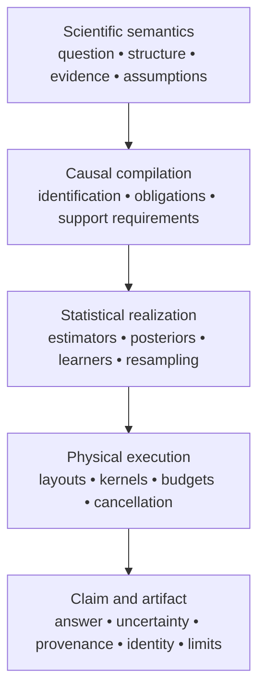

# Architecture overview

Antecedent is organized around meaning preservation, not around a collection
of estimators. Scientific semantics flow into causal compilation, statistical
realization, physical execution, and then a claim or artifact. A later layer
may add information or perform work, but must not silently strengthen what an
earlier layer established.



[How Antecedent works](../concepts/how-antecedent-works.md) is the practitioner introduction. This page records the corresponding engineering rules and crate ownership; see also [compiler layers](compiler-layers.md).

## Invariants

1. **Identify before estimate.** Estimators never choose confounders or assert identifiability.
2. **Graph classes stay distinct.** DAG, ADMG, CPDAG, PAG, and temporal variants are not aliases.
3. **Uncertainty sources stay distinct.** Parameter, sampling, graph, orientation, identification, mechanism, regime, and measurement uncertainty are separate fields — not collapsed into one CI.
4. **Bayesian inference does not erase non-identifiability.** Priors/restrictions are recorded as assumptions.
5. **One workflow for static and temporal.** Modality is compiled from data + query, not a second API.
6. **Discovered structure is evidence.** Review, constraints, and completion are explicit.
7. **Heavy work stays in Rust.** Python crosses at coarse operations only.
8. **Results are reproducible.** Schema, preprocessing, graph version, assumptions, config, seeds, backend versions, and warnings attach to artifacts.
9. **Parity is capability parity**, not Python API cloning.
10. **Performance is part of the feature.** Hot paths need benches, allocation profiles, and explicit memory/layout contracts before merge.
11. **The support matrix is the license.** A public query × graph class ×
    inference cell is licensed, n/a, or refused. Capabilities pages inventory
    implementations; they do not license a cell. `analyze` is sugar over the
    staged path.

## Implementation architecture

```text
antecedent-core          ids, schemas, queries, interventions, identities, execution policy, errors
antecedent-contract      claim envelopes, external-evidence contracts, program bindings, obligations (no estimator dependency)
antecedent-kernels       borrowed views + scalar/portable/arch kernels (no causal semantics)
antecedent-data          tabular / temporal / panel / multi-env views, sample planning, Arrow
antecedent-graph         DAG/ADMG/CPDAG/PAG, separation, overlays, temporal unfold
antecedent-expr          arena-backed causal-functional IR
antecedent-stats         regression, covariance, resampling, CI tests, faer LA backend
antecedent-learn         prediction contract: DesignView, LearnerFactory, FittedPredictor
antecedent-prob          posteriors, priors, graph samples, inference backends
antecedent-discovery     PC/FCI/GES/LiNGAM/NOTEARS, PCMCI family, Bayesian DAG engines
antecedent-identify      adjustment, IV, front-door, mediation, ID/IDC, envelopes
antecedent-io-core       container, codecs, wires, digests, the analysis-result consumer, estimator-free artifacts (below estimate)
antecedent-estimate      frequentist + Bayesian estimators for identified functionals
antecedent-model         SCMs, mechanisms, intervention overlays, sampling
antecedent-counterfactual  abduction–action–prediction
antecedent-attribution   anomaly / distribution / mechanism / path / Shapley
antecedent-validate      refuters, sensitivity, discovery stability, Bayesian checks
antecedent-design        EIG / VoI / experiment ranking (computation only; depends on io-core, never on estimate or validate)
antecedent-state         incremental caches, invalidation, sufficient statistics
antecedent-io            estimator-bound artifacts; re-exports antecedent-io-core
antecedent               facade: Study planner + re-exports
```

Dependency edges point downward (no cycles). Facade (`antecedent`) sits on top.
`antecedent-io-core` holds everything that replays without an estimator,
including the analysis-result consumer, so `antecedent-design` reads artifacts
through it and reaches neither `antecedent-estimate` nor `antecedent-validate`;
`antecedent-io` adds the artifacts whose replay runs an estimator or validator.
A crate that owns an error type owns its conversion into a lower crate's error
(`From<EstimationError> for IoError` lives in `antecedent-estimate`).
`antecedent-estimate` depends on `antecedent-learn` for nuisance
prediction and never names Forust, SmartCore, or other ML
providers (ADR 0023).
`antecedent-model` depends on `antecedent-learn` for the tree-ensemble mechanism
families: it fits through the learner contract and stores only the provider-independent
tree map (`PortablePredictor`), so it too never names a provider (ADR 0012).
Bayesian discovery may use `antecedent-prob` without pulling `antecedent-model`.

`scripts/check_architecture.py` checks these production ownership boundaries
transitively, including renamed workspace dependencies, optional features,
build dependencies and platform-specific edges. It runs in CI and the release
inventory gate. Development dependencies may test independent consumers without
becoming production dependencies. Its negative controls run with
`python3 scripts/test_check_architecture.py`.

The [engineering review](https://github.com/iridae-dev/antecedent/blob/main/parity/engineering_pass/README.md) records the
reviewed caller chains, fixes, compatibility decisions and executing checks.

Prepared functional operations retain their checked causal program separately
from the data-bound empirical provider. Rebinding new data reuses that program;
reading a contract on the producing snapshot reuses the provider's factor laws.
Schema compatibility is checked separately from storage-content equality, and
values, validity, masks and weights participate in the latter. Refresh publishes
the rebound operation that produced its result. Scientific program identity,
snapshot identity and physical preparation counters therefore remain distinct.

Portable predictor deserialization validates the same numerical-map invariants
as checked construction. Public declaration records remain compatible, and
their consuming fallible operations validate shape and domain before indexing.
An empty or failed posterior draw column cannot publish a finite probability.

## Analysis pipeline

```text
data (+ optional discovery)
  → graph / GraphEvidence
  → identify → IdentifiedEstimand
  → estimate | posterior
  → validate (optional)
  → StudyResult (+ plans, provenance, diagnostics)
```

Compilation produces an inspectable **logical** plan (semantics) and **physical**
plan (layouts, kernels, batching, parallelism, memory). Physical choices must not
change logical semantics.

`run()` auto-accepts only when the graph is fully specified for the query;
otherwise compilation returns `ReviewRequired`.

## Execution model

- `ExecutionContext` owns thread budget, RNG seeds, memory limits, and kernel policy.
- No private global thread pools; no recursive oversubscription.
- `ComputeBudget.wall_ms` is advisory: it is recorded on the resolved budget and
  is not a hard wall-clock stop. Use a cancellation token to abort.
- Workspaces and prepared designs are reused across bootstrap / draw batches.
- Residual-fit process reuse requires explicitly enabled unbounded caching and an
  unlimited admission pool. Disabled/bounded caches and finite admission bypass
  both lookup and retention; pure numerical equivalence does not override ownership.
- SIMD is an implementation detail behind library-owned views (`KernelPolicy`).
- Python callbacks are explicit slow paths; the physical plan marks them.

## Python package

The public product and PyPI name is **Antecedent** (`import antecedent`).

```text
python/
  src/lib.rs             # PyO3 → antecedent._native
  antecedent/            # pure-Python wrappers + stubs
```

Algorithms stay in Rust. Bindings convert and release the GIL. Identification and
validation surface through `analyze(...).identification` / `.validation`, not
separate top-level modules.

Each detached run owns its pending Python exceptions through attribution and
worker join. Attribution can consume only that run's callback ids; formatting
and Python object destruction happen outside ownership locks. Progress callbacks
carry a weak run owner into native workers and restore their previous scope.
Callback interruptions cancel linked work and survive successful native fallback;
ordinary observer exceptions retain their print-and-continue contract.

## Where to look next

| Topic | Location |
|-------|----------|
| Artifact wire format | [artifacts.md](../artifacts.md) |
| Hot-path benches / budgets | [hot_paths.md](../hot_paths.md) |
| Capability inventories | [parity/](https://github.com/iridae-dev/antecedent/blob/main/parity/README.md) |
| ADRs | [adr/](https://github.com/iridae-dev/antecedent/blob/main/adr/README.md) |
| Conformance fixtures | [conformance/](../conformance/README.md) |
| Security / unsafe / license review | [security_review.md](../security_review.md) |

The [multi-source transport and retained-grid architecture](transport-meta-grid.md)
describes the μsID theorem scope, provider aliases, common prepared lifecycle,
pointwise inference, and independent durable-claim verification.
