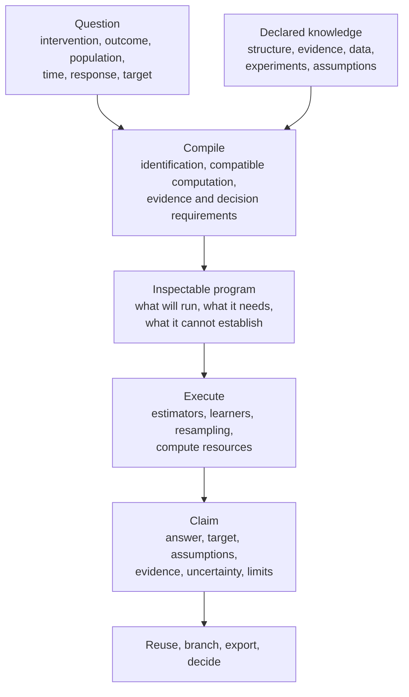

# How Antecedent works

Antecedent is a compiler and runtime for causal science. You declare a question and the knowledge and evidence you bring to it. Antecedent compiles those declarations into a program you can inspect before running, executes the program, and returns a claim that keeps its question, assumptions, uncertainty and limits attached. The claim can then be reused, branched onto new data, exported or passed to a decision.



The rest of this page follows that path.

## What is compiled

"Compiler" has a literal basis. Antecedent does not introduce a new language; you write ordinary Python or Rust values (a graph, a query, an inference choice). What it compiles is the scientific problem, in layers:

| Layer | What it holds |
| --- | --- |
| Scientific problem | The query (what is changed, the outcome, the population, the time), the schema, the structure, the assumptions |
| Identification | Whether the declared structure and evidence determine the requested quantity, and the formula that does so |
| Statistical program | How the identified quantity is estimated: estimator, learners, posterior or resampling scheme |
| Evidence and decision requirements | What a decision, a composition or a transport needs from the analysis (a mean, a posterior, an outcome law) |
| Physical execution | Layouts, kernels, thread and memory budgets, cancellation |
| Claim | What the execution must publish and what it may say |

Each layer may add work or information. None may strengthen what an earlier layer established. An estimator fits a nuisance function; it does not choose confounders or declare an effect identified. A compute budget can stop a search; it does not prove that no solution exists.

Preparing a study performs no fit, and inspecting a prepared study shows the program that execution will run. For the checked Gaussian route, tests assert that preparation fits nothing and that inspection and execution share the same retained product.

## The lifecycle

The runtime lifecycle is one immutable chain:

```python
import antecedent as ant

study = ant.prepare(data, graph=graph, query=query)   # validate, identify, own the inputs; nothing is fitted
study.inspect()                                       # read the program before running it
outcome = ant.estimate(study)                         # execute once; returns an Outcome
branch = ant.rebind(study, data=new_data)             # a new study on new observations; the source is unchanged
artifact = outcome.export()                           # a portable record of the result
loaded = ant.load(bytes(artifact), expected=artifact.expectation)
```

This block is a sketch of the call shapes; the [first analysis](../start/first-analysis.md) runs each step. `ant.analyze(...)` is the one-shot form of prepare and estimate. `ant.reconfigure(...)` branches a study onto new declarations, and `branch.reuse` names what was retained and what was invalidated. Each operation returns a new object; the earlier study and result stay as they were.

An `Outcome` holds either the result or a typed scientific refusal. Operational failures (an invalid argument, cancellation, a resource limit) raise instead. [Refusals](refusals.md) explains the distinction.

## What travels with a result

Four questions travel with every claim:

| Question | Meaning |
| --- | --- |
| Identification | Do the assumptions and available evidence determine the requested quantity? |
| Support | Does the actual data cover the population, intervention or region the answer needs? |
| Uncertainty | What remains uncertain, which sources are represented, and what supports a reported interval? |
| Assumptions | What was taken as given to make the claim? |

The slots stay distinct. A predictive model cannot create identification, more rows cannot repair a missing causal assumption, a diagnostic cannot prove a graph, and a prior cannot turn structural nonidentification into an identified effect. [Results are claims](results-are-claims.md) describes how to read them together.

## Structure is evidence

Supplied, discovered, accepted, partial and posterior graph structures have different status, and DAGs, ADMGs, CPDAGs, PAGs and temporal forms stay distinct. A discovered graph is evidence, not ground truth. When structural uncertainty remains, a point estimate is not substituted for a bound or partial answer to simplify a downstream interface.

## Identity makes changes explicit

The same number can arise from different analyses. Antecedent tracks the target, the identification product, the program, the inference configuration, the observation contract, the data snapshot and the execution separately. Refreshing with compatible data, retargeting a population, changing the structure and re-estimating are therefore different operations with different consequences. A result's identity is what lets an exported artifact be checked against what a consumer expects, and what lets a prepared study say which parts of earlier work still apply.

## One workflow for static and temporal questions

Whether an analysis is static or temporal follows from the data and the query, not from a second interface. Queries, intervention programs, decisions and further-study ranking use the same prepare, inspect, execute and consume path.

## Where the work happens

Estimation, identification, discovery and numerical kernels run in Rust; Python crosses into Rust at coarse operations. The Python package is `antecedent` (`import antecedent`). The execution context owns the thread budget, random seeds, memory limits and cancellation. A wall-clock budget is advisory and is recorded; use cancellation to stop a run. Python callbacks are explicit slow paths, and the physical plan marks them.

The internal layering and crate ownership are maintainer material; see the [architecture notes](../architecture/compiler-layers.md).

## Where next

- [Results are claims](results-are-claims.md): reading the answer with its standing.
- [Interventions and worlds](interventions-and-worlds.md): what "change this variable" can mean.
- [Uncertainty](uncertainty.md) and [refusals](refusals.md).
- [Assurance](assurance.md): the evidence behind the capability claims.
