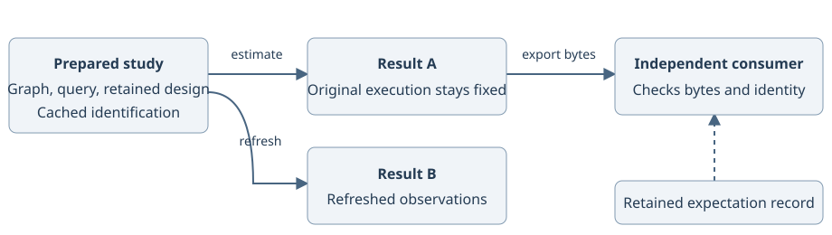

# From a notebook to a scientific system



Start with one reviewed question, then preserve its meaning as observations, design and consumers change. This tutorial uses synthetic data and the same public API as the runnable script. No bootstrap interval is requested here; inspect the actual standing of every result before using uncertainty downstream.

```bash
python examples/python/notebook_to_system_24.py
```

Install the matching package or development checkout using [installation](../installation.md). The [companion notebook](https://github.com/iridae-dev/antecedent/blob/v2.4.0/examples/notebooks/notebook_to_system_24.ipynb) presents the same journey interactively.

## 1. Prepare the question before fitting

The script declares a graph, an average effect and a synthetic table. `ant.prepare` retains identification. `study.last_result` is `None`, and `study.inspect_plan()` describes a prepared, unexecuted question. Its uncertainty is unavailable because there is no execution yet.

## 2. Estimate and inspect an immutable execution

`study.estimate()` computes the effect. `result.refute(suite="cheap")` adds the requested diagnostics for that execution. The script asserts that refutation preserves the estimated value. Passing diagnostics does not establish that the graph is true or that an interval is calibrated.

## 3. Refresh observations without rewriting history

The updated outcome adds one treatment unit, so the refreshed estimated effect increases by exactly one. The preceding `result` still describes its original snapshot. Refuting it after refresh checks that original execution, not the latest table.

## 4. Reprepare when the scientific design changes

The second study names randomized assignments and unit IDs by column. A changed assignment column refuses refresh and leaves the preceding successful result intact. Outcome-only refresh keeps the design. `study.reprepare(changed_design)` creates a new study, resolves the named declarations and repeats scientific checks. Reversing assignments reverses the effect in this example.

## 5. Bind a mean to a consumer's scientific quantity

The composition example supplies a mixture mean. Its adapter explicitly declares units, population and regime before a decision consumes it. That binding preserves the source's standing; a mean does not supply a joint law or an interval.

## 6. Export and consume in a fresh process

`checked.artifact()` yields bytes plus an expectation the producer can retain separately. The fresh subprocess reads the bytes and separately retained identity and checks that the answer is preserved. Loading never invokes a callback or recreates a live study. See [the producer/consumer recipe](artifact-handoff.md) for persistent files and invalid-consumption examples.

## Complete runnable source

<!-- example: examples/python/notebook_to_system_24.py -->

Expect prepared and executed inspection reports followed by `Fresh-process consumption preserved the answer and identity bindings.` The assertions check the designed numerical changes, immutable execution, refused design update, composition binding and fresh-process load.

Continue with [measurement to decision](../tutorials/measurement-to-decision.md), [refusal and repair](refusal-recipes.md), or [the 2.4 migration](../migrations/2.4-python-ux.md).
