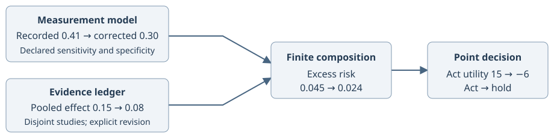

# From a noisy measurement to a revised decision

This example asks whether a programme's expected benefit exceeds its cost. The answer depends on a corrected exposure prevalence and two disjoint studies' effect summaries. All inputs are declared synthetic summaries. This tutorial produces point decisions; it does not establish interval coverage.

## Check the story by hand

| Stage | Calculation | Value |
| --- | --- | ---: |
| Correct prevalence | `(0.41 + 0.8 - 1) / (0.9 + 0.8 - 1)` | 0.30 |
| Pool two equally precise effects | `(0.10 + 0.20) / 2` | 0.15 |
| Compose excess risk | `0.30 × 0.15` | 0.045 |
| Act utility | `1000 × 0.045 - 30` | 15 |
| Hold utility | No programme benefit or cost | 0 |
| Revised pooled effect | Inverse-variance pool of 0.10 and 0.07 | 0.08 |
| Revised act utility | `1000 × 0.30 × 0.08 - 30` | −6 |

Benefit and cost share one declared utility scale. Here the cost of 30 means 30 utility units; a monetary cost would need an explicit conversion before being subtracted from avoided cases.

The decision changes from act to hold because the second study grows from 300 to 600 declared observations, becomes more precise, and its estimated effect falls. The ledger marks the old pool as needing recomputation; the successor pool replaces it, and the finite model and decision are rebuilt. The measurement model's sensitivity and specificity are premises; pooling requires declared disjoint evidence; the finite mechanisms are declared compatible tables. Each step has a distinct obligation.

<!-- example: examples/python/measurement_to_decision.py -->

## Interpret the boundaries

The composition preserves the distinction between recorded exposure and latent exposure. A common column name alone would not establish that relationship. The ledger tracks evidence identity so reused observations are not counted as new evidence. The decision reads an explicitly declared mean quantity with units and population.

A standard error is not an interval license. The example's point-only calculation must not be presented as a posterior decision probability. For aligned uncertainty, continue with [joint-law propagation](../joint-law-propagation.md); for revising a larger claim graph, see [composition verification](../composition-verification.md).

The [release-boundary fixture](../composition-release-fixture.md) extends this story with portable artifacts, fresh-process consumption, withdrawal, dependence gaps, and mutation checks. [The artifact handoff recipe](../guides/artifact-handoff.md) teaches the process boundary separately.
